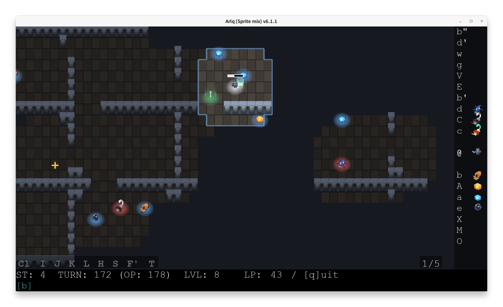
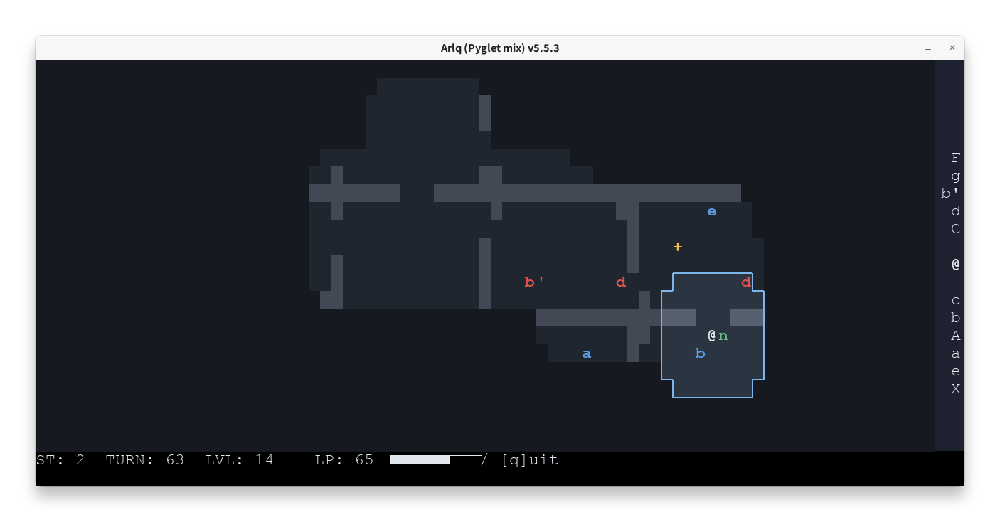
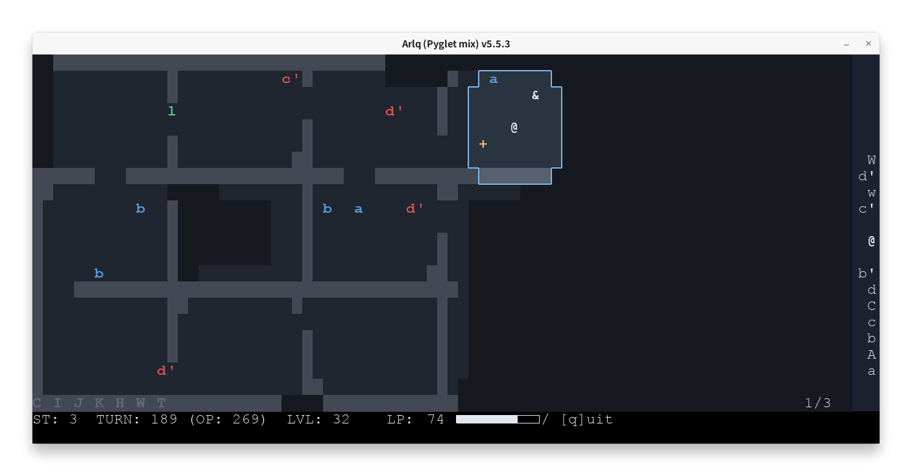
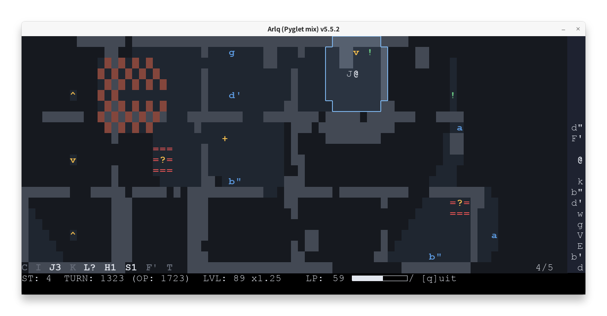
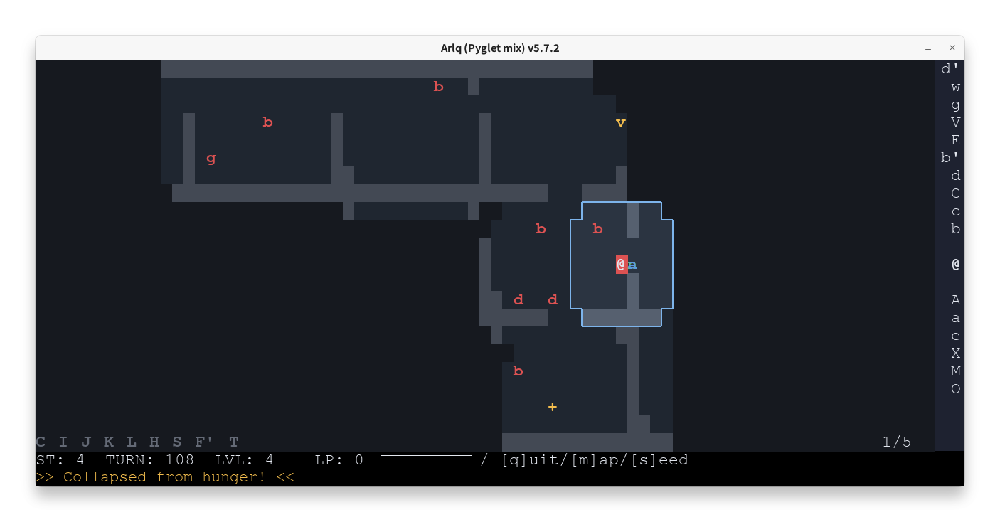

# ARLQ, another rogue-like quest game

ARLQ（Another Rogue-Like Quest）は、人間とAIsが共同で作成した実験的なローグライクゲームです。PygletとBlessed端末UIに対応したPython実装です。

<p align="center">
  <a href="https://pypi.org/project/arlq/">
    
  </a>
  <a href="https://www.python.org/">
    
  </a>
</p>



<a href="docs/images/screenshot2.png"></a>
<a href="docs/images/screenshot3.png"></a>
<a href="docs/images/screenshot4.png"></a>
<a href="docs/images/screenshot5.png"></a>

## インストールと起動

Python 3.10以降が必要です。リリース版は以下のコマンドでインストールできます。

```bash
pipx install arlq
```

GitHub上の最新版を直接インストールする場合は、以下を実行してください。

```bash
pipx install git+https://github.com/tos-kamiya/arlq
```

必要なPygletとBlessedも自動的にインストールされます。
インストール後、`arlq`、`arlq-sprites`、`arlq-cli` を実行できます。

```bash
arlq
arlq-sprites
arlq-cli
```

## コマンドラインオプション

### `arlq-cli`、`arlq`、`arlq-sprites` 共通のオプション

| オプション | 説明 |
| --- | --- |
| `--version` | バージョンを表示する |
| `--rematch` | 前回のステージとシードを再利用する（同じ配置を再現するには他のレイアウト関連オプションも同じにする）。`--seed`とは併用できません。`--stage`は前回と同じステージを指定する場合に併用できます。 |
| `--seed VALUE` | 整数のシードまたはバージョン付きシード文字列を指定する |
| `--stage 1`、`--stage 2`、`--stage 3`、`--stage 4`、`--stage 5`、`--stage 6` | ステージを直接選択する。ステージ5はメンバー能力を試す小さなステージ、ステージ6は3フロアのボス・宝箱探索。 |
| `--lang en`、`--lang ja`、`--lang auto` | ゲーム内メッセージとステージ選択画面の言語を指定する。`auto`（既定）はロケールから自動判定する。ステータスバーの略語やアイテム名は常に英語で表示する。 |
| `--debug-show-entities` | 未発見のエンティティも表示する |

ゲーム開始時にステージとシードをユーザーのキャッシュディレクトリ内の
`arlq/last-seed` に保存します。`--rematch`だけで前回のステージを直接開始できます。
`--seed`を併用した場合、前回と異なる`--stage`を指定した場合、または保存値がない・壊れている場合はエラーになります。

ゲームは独自実装のMT19937を使うため、同じゲームバージョン・シード・設定であれば、Pythonのバージョンが異なっても配置を再現できます。以前の乱数生成器からの変更に伴い、以前のシードの配置は変わり、以前のトレースは正しく再生できない場合があります。整数シードの下位32ビットを使用します。

#### 難易度調整オプション

| オプション | 説明 |
| --- | --- |
| `-T` / `--large-torch` | 視界を広げる |
| `-t` / `--small-torch` | 視界を狭める |

### `arlq` のみで使えるオプション

| オプション | 説明 |
| --- | --- |
| `--terminal` | Blessedを使用した端末UIを起動する |
| `--scale FACTOR` | Pyglet GUIの表示倍率を変更する（`0.5`～`4.0`、例: `--scale 1.5`）。倍率はユーザーごとの設定ディレクトリに保存され、次回のGUI起動時にも自動的に使われる。ステージ選択画面の `設定` メニューからも変更できる。 |
| `--key-repeat-interval SECONDS` | GUIの移動キーリピートの開始待ち時間と間隔を設定する（`0.1`～`1.0` 秒）。`none`を指定すると無効にできる。値は次回起動用に保存され、ステージ選択画面の `設定` からも変更できる。 |
| `--auto-repeat-stop` / `--no-auto-repeat-stop` | 既知の危険箇所や遭遇後に自動リピートを停止する機能を有効・無効にする（初期設定は有効）。値は次回起動用に保存され、ステージ選択画面の `設定` からも変更できる。 |

`設定`の`戦闘エフェクトの表示時間`で、戦闘とバリアダメージのエフェクトを0、0.1、0.2、0.3、0.4、0.5秒から選べます（初期値0.3秒）。0秒ではエフェクト表示と待ち時間を省きます。選択は保存され、ターミナルモードにも適用されます。`arlq-sprites` では、`階の移動の表示時間`で、階と階の間の止め絵の表示時間を0〜1秒（0.1秒刻み、初期値0.5秒）から選べます。0秒では表示しません。
`arlq-sprites` では、`キャラクターの揺れ`で、入力待ちの間に視界内のキャラクターが0.7秒ごとに小さく上下する表示をオン・オフできます（初期値オン）。プレイヤー、モンスター、妖精、マップ上で待っているエルフとパーティーメンバーが揺れ、ついてきている妖精とパーティーメンバーは揺れません。

戦闘とバリアダメージのエフェクトは、1手分の処理後、マップの更新前に表示します。
`arlq-sprites` では演出中も画面を更新し、その間に押したキーを次の入力まで保持します。
`arlq-sprites` では、勝った戦闘の斬撃のエフェクトを、プレイヤーが攻撃した方向（上下左右）に合わせた形で表示します。

## 画面と操作

`arlq-cli` は端末版、`arlq` は文字表示のGUI版、`arlq-sprites` はキャラクターをスプライトで表示するGUI版を起動します。

### 全モード共通

ステージ選択は `[1]`～`[6]` を横2列・縦3行で表示し、数字キーで直接選択できます。GUI版ではゲームパッドも使え、ボタンの割り当ては「設定 → ゲームパッドボタン設定」で変更できます。

プレイヤーのキャラクター（`arlq-cli` と `arlq` では `@` の文字）を矢印キーまたはWASDで操作します。視界はプレイヤーを中心に広がり、探索済みの場所はオートマップに残ります。

敵と接触すると、直前に遭遇した敵パーティーの構成が `[aaw]` のようにメッセージ欄の左側に表示されます。一時的な効果ポップアップはプレイヤーの近くに、イベントメッセージは画面下部に表示されます。効果ポップアップのLP・LVLの増減は小数点以下1桁までに丸め、末尾の `.0` は省略します。

### 端末：`arlq-cli`

Blessedによる端末版は、80桁×24行以上の端末が必要です。それより小さくするとゲームは一時停止し、十分な大きさに戻すと再開します。`arlq --terminal` でも端末版を起動できます。

### スプライト表示GUI：`arlq-sprites`

`arlq-sprites`（または `arlq --sprites`）でキャラクタースプライト版GUIを起動できます。起動時はフィールド全体と強さ欄が収まり、スクロールせずに見える幅で開きます。ウィンドウは縦横にサイズ変更できます。高さを変えるとフィールドが拡大・縮小し、描画の細かさは一定に保たれます。ウィンドウをフィールドより狭くした場合はカメラがプレイヤーを追い、Shift＋左右矢印キーで表示範囲を3マスずつ動かせます。

主人公が剣を持っているときは、剣を手に持っている画像になります。主人公は直前に移動しようとした方向を向きます（壁や負けた戦闘でその場に留まったときも同じです）。ステージの開始時と、階段・落とし穴・ループによる巻き戻しのあとは正面を向きます。LPゲージは格闘ゲームのように主人公のすぐ上に表示されます。足元の円盤は、モンスターが判明しているかやその強さ、プレイヤーの状態を表します。

マウスをキャラクターに合わせると、キャラクターを大きく表示し、頭上に名称を表示できます。未識別の場合は名称を表示しません。

プレイヤーの隣のマスのキャラクターは大きく表示します。ただし、プレイヤーについてきているパーティーメンバーとJエルフは、プレイヤーより大きく見えないよう、85%程度の大きさで、輪郭の線を弱めて表示します。

## ゲームの説明

### 目的

ダンジョンを探索し、ステージのボスを倒して宝箱の封印を解除し、宝を手に入れます。後半のステージではエルフが攻略を助けます。

LPはプレイヤーの生命力で、移動やダメージで減少し、0になるとゲームオーバーです。モンスターを倒すとLPが回復します。LPが40以下になると背景が黄色に、20以下では赤に変わります。

レベルはプレイヤーの強さを表します。モンスターを倒すと経験値を獲得し、その分だけレベルが上がります。

全ステージで、開始時は通常上限100を一時的に超えるLP120を持ち、序盤の探索に余裕があります。上限を超えている間、ゲージはマゼンタ色になります。超過分はモンスターを倒しても補充できません。敗北後の復帰ではLPを6減らした後、最低20を保証し、上限による切り下げは行いません。開始時の余剰を再付与することはありません。

### プレイヤーのサポート機能

| 機能 | 説明 |
| --- | --- |
| 移動リピート | 既知の危険へ近づいたときや遭遇・特殊移動の後に自動停止します。初期設定で有効で、設定画面または `--no-auto-repeat-stop` で無効にできます。方向入力を離して押し直すと再開します。 |
| 到達可能範囲の表示 | `F` で残りLPで到達できる探索済みセルを淡い青で表示・非表示にします。ゲームパッドではボタンを押している間の表示、または切り替えが可能です。表示中に上下を入力するとステージ3・4の別フロアを確認でき、キーボードでは移動すると表示を閉じます。未探索セルと経路は表示せず、表示中のエンティティや階段を避けます。壁破壊、LP回復、マークスマンとアイビーのダメージは考慮しないため、実際の到達範囲と異なる場合があります。 |

### モンスター・妖精・エルフ

未遭遇のモンスターは `?`、妖精は `!`、正体が判明していないエルフは `&` と表示されます。接触すると種類が判明します。ランク1のアメーバ（`a`）は全ステージで最初から判明しています。強化個体は別に判別されます。

モンスターの種類の判別はフロアをまたいで保持されます。一方、妖精の種類は全ステージでフロアごとに判別されるため、新しいフロアでは未遭遇の妖精が再び `!` と表示されます。

`arlq` と `arlq-cli` の右側の攻撃力表示では、判別済みのモンスターを白、未判別のモンスターを灰色で表示します。

通常のモンスターに接触すると戦闘になり、敵のレベルが自分の現在の攻撃力以下なら勝利します。通常はレベルが1上がりLPが回復しますが、LPを回復しない敵や、LP・レベルを減らす敵もいます。勝利した位置が次のチェックポイントになります。強いモンスターに敗北するとチェックポイントへ戻り、所持アイテムを失います。他のモンスターに接触せず同じモンスターに連続で2回敗北すると、マップ上のランダムな位置へ移動します。階段や落下によるフロア移動でもチェックポイントが更新されます。

通常のモンスターを倒すと、相手が何も持っていなくても所持アイテムが置き換わります。毒や胞子もこの方法で解除できます。ステージ3・4で未面会のエルフに接触すると胞子が解除され、ライフブリンガーは毒も解除します。

モンスターの中には、 `d` のように、リスポーンするものもいます。モンスターのスポーン・リスポーンは、プレイヤーのいる階のプレイヤーを中心とした5×5マスを避けます。配置できない場合は、その回の出現を見送ります。また、ステージのボス敵であるモンスターを倒すと宝箱の封印が解除されます。解錠された `T` に接触するとクリアです。

妖精は一定期間、固有の能力を提供し、一度に1体だけ連れられます。モンスターとの戦闘接触1回につき期間を1単位消費します。パーティー戦は敵の数にかかわらず1回として数えます。ペガサスのジャンプでも1単位消費します。例えば、ノミコンは視界内のモンスターとエルフの正体を明らかにします。

エルフの多くはステージ3以降に登場し、プレイヤーが一定の条件を満たすと、攻撃力強化などのサポートを与えます。

### モンスターのレアタイプと強化個体

一部のモンスターには、通常個体とは異なる特徴を持つレアな個体が存在します。例えば `A`（レアアメーバ）は大幅にレベルアップでき、`C`（レアキメラ）は攻撃力を大きく高める呪われた剣を与えます。一方、`E`（レアエレボス）はプレイヤーのレベルを減らします。

一方、ステージ2以降には強化個体も登場します。強化個体はレアタイプとは異なり、プレイヤーにとっての恩恵ではなく、通常個体より強い敵です。rank 2の強さは通常レベル×3+10、rank 3はその3倍です。画面ではrank 2を `b'`、rank 3を `b"` のように表示し、それぞれ通常個体とは別の種類として判別されます。

### パーティーメンバー

ステージ5・6では、固有の能力で戦闘や探索を助けるパーティーメンバーを最大2人まで仲間にできます。最初の仲間は同行し続け、3人目以降が加入すると2人目が交代します。例外としてJはレベル100以上になると脱退しますが、100未満に下がると再加入できます。仲間は加入順にプレイヤーの通ったマスをたどり、ペガサスでジャンプすると着地点に移動します。

## 妖精一覧

| 表示・名前 | 能力 |
| --- | --- |
| **l** ループ妖精 | ステージ3〜4に登場する。接触すると最大80ターン巻き戻す（経過ターン数が短い場合は開始時点まで）。 |
| **n** ノミコン | 視界内にいる活動中のモンスターとエルフの種類を判別する。 |
| **o** オキュラー | 視界を大幅に広げる。 |
| **p** ペガサス | ステージ2以降に登場する。壁を越えて移動できる。バリアへの着地にはバリア無効化またはGの同行が必要。R同行時は着地点のゴーレムの残骸を除去する。 |

※ ループ妖精：巻き戻った時点が新たなアンカーとなり、以降は別フロアのループ妖精に接触しても、そのアンカーより前には戻らない。探索済みマップ、判別済みの敵の種類、判明したエルフやメンバーの居場所は保持される。探索情報はヴォルテックスによる既知範囲の消去も含め、巻き戻し直前の状態を引き継ぐ。乱数生成器は巻き戻さず、その時点の状態から使い続けるため、以後の出現などは元の未来と異なることがある。巻き戻し後10ターンは、失われた未来で通った経路を水色の「.」で表示する。

## ステージ一覧

### ステージ1: 最初のダンジョン

| 表示・名前 | 説明 |
| --- | --- |
| **a** アメーバ | 最初から倒せる弱い敵。レベルアップに役立つ。 |
| **A** レアアメーバ | 経験値は通常の1ではなく10。 |
| **b** バイソン | 倒すとLPを大きく回復する。 |
| **c** キメラ | 剣を持ち、攻撃力が1.5倍になる。壁を3回まで壊せる。 |
| **d** コモドドラゴン | 強力でLPを回復するが、毒を残し、攻撃力が1/3（端数切り上げ）になる。 |
| **D** 竜 | 竜の宝箱を解錠する。 |

### ステージ2: フルサイズダンジョン

ステージ1の竜以外のモンスター・妖精に加えて、次の敵が登場します。

ステージ2には強化個体のバイソン（`b'`）も登場します。ステージ6にはバイソン（`b`）とバッファロー（`B`）が登場します。

| 表示・名前 | 説明 |
| --- | --- |
| **C** レアキメラ | 呪われた剣で攻撃力が3倍になる。モンスター・エルフへの接触時と壁を壊すたびに追加でLPを10消費する。通常の剣と同様に壁を3回まで壊せる。 |
| **e** エレボス | 戦闘時にLPを少し奪う。 |
| **F** 火竜 | 火竜の宝箱を解錠する。 |
| **g** ゴーレム | 倒すとプレイヤーの斜め4方向にそれぞれ2マス先まで岩が飛び散り、そこにある壁・バリア・まきびしも残骸に置き換わる。食料は得られない。文字版GUIとターミナルでは、探索済みの残骸を `+` で表示する。 |
| **H** ハイエルフ | ステージ2では受動的なエルフ。接触すると正体が判明するが、戦闘や報酬はない。 |
| **X** まきびし植物 | 接触したセルを中心に、周囲へまきびしを市松模様に撒く。接触位置によらず模様は同じ。壁やバリアを置き換えるが、ゴーレムの残骸は置き換えない。隠し通路と落とし穴の上り口は、まきびしや残骸、バリアに置き換わらない。rank 2の `X'` は配置半径が1マス広い。 |

再出現待ちの処理は65ターン周期で行われます。レアエレボス（`E`）と大渦（`V`）はステージ4のランダムな階に再出現します。まきびし植物（`X`）はステージ2・3・4に登場し、ランダムなフロアに再出現します（ステージ2は1フロア）。

### ステージ3: エルフのいるダンジョン

ステージ3は3つのフロアで構成され、エルフ（`I`、`J`、`K`、`H`）が登場します。バイソン、キメラ、コモドドラゴンの強化個体（`b'`、`c'`、`d'`）も現れます。

画面には現在のフロアとエルフの進捗が表示されます。GUI版はShift＋上／下キー、`arlq-cli`はShift＋W／Sキーで別のフロアを確認できます。未探索の場所は隠れたままです。移動するとプレイヤーのいるフロア表示に戻ります。

#### モンスター

| 表示・名前 | 説明 |
| --- | --- |
| **m** 胞子モンスター | 倒すと胞子を浴び、視界が狭まる。 |
| **w** ウィルム | どのランクでも経験値は5。バリアに守られている。 |
| **W** ドレッドウィルム | どのランクでも経験値は5。バリアに守られており、討伐すると宝物庫が開く。 |

#### エルフ

| 表示・名前 | 説明 |
| --- | --- |
| **I** 隠者エルフ | 他のエルフに関する情報を伝える。壁で閉じた部屋にいる（剣で壁を壊す、ペガサスで飛び込む、階段や崩落で入るなどの手段が必要となる）。2回以降の接触ではプレイヤーをマップ上のランダムな位置に移動させる。 |
| **J** ジャベリンエルフ | プレイヤーに同行し、攻撃力を25%高める。敗北時はプレイヤーと一緒に戻る。 |
| **K** コレクターエルフ | レアキメラ（`C`）を倒した後に会うと、恒久的な攻撃力1.2倍の強化を与え、現在の所持アイテムを解除する。呪われた剣を持ち続けている必要はない。この強化では壁を壊せない。 |
| **H** ハイエルフ | `I`、`J`、`K`、`L`、`S` のうち2名以上の助力を得ると護身のアミュレットを授ける（ステージ3に登場するのは `I`、`J`、`K`）。 |

ハイエルフ(H)とコレクターエルフ(K)は、条件を満たしていない状態で接触すると、初回はメッセージを表示するだけですが、2回目以降はマップ上のランダムな位置へ移動させられます。

バリア（`=`）に入ると追加でLPを30消費します。護身のアミュレットがあればこの消費を防げますが、呪われた剣を所持している間は防げません。コレクターとジャベリンの攻撃力補正は、剣や毒などの補正に重ねて適用されます。

`arlq` と `arlq-cli` では、バリアは30 LPのダメージを受けるとき赤い背景に黒い文字で表示します。Gが同行しているときは通常の背景に赤い文字で、アミュレットがダメージを防ぐときは控えめな赤い文字で表示します。

`arlq-sprites` では、バリアは床から立ち上る橙色の光で表示します。プレイヤーの周り（自分のマスと周囲8マス）のバリアは、Gがダメージを軽減するときは面積が約4分の1で光も低い小さなバリアに、アミュレットがダメージを防ぐときは薄い灰色の煙になります。

### ステージ4: 深い迷宮

ステージ4は5つのフロアで構成され、ステージ3に加えて新しいエルフ、モンスター、トラップが登場します。ボスは強火龍（`F'`）です。

#### モンスター

| 表示・名前 | 説明 |
| --- | --- |
| **E** レアエレボス | 倒すとプレイヤーのレベルが2/3（端数切り捨て、最低1）になる。 |
| **k** マークスマン | 経験値は3。水平または垂直方向に矢を撃ち、命中するとLPを4奪う。ただし、隣接したセルには撃たない。壁、階段、妖精、待機中のパーティーメンバー、宝箱、活動中のモンスターは矢を遮るが、まきびし（`x`）、崩落地形（`O`）、バリアは遮らない。撃破後は195ターン周期で再出現する。 |

#### トラップ

トラップは、宝箱に偽装したりフィールドを変化させたりする特殊能力を持つモンスターです。

未発見のトラップはモンスターと同様に `?` と表示されます。ただし、ミミックのみは宝箱と同じタイミング、文字で出現します。

| 表示・名前 | 説明 |
| --- | --- |
| **T** ミミック | ステージボスを倒すと宝箱と同じ姿で現れる。レベルは1で、倒すとプレイヤーは同じフロア内のランダムな位置へ移動する。 |
| **?** / **O** 崩落 | `?`のセルに入ると、壁のあるセルを除く上下左右に落とし穴（`O`）が現れる。次のムーブで穴に入ると、下のフロアへ落ちる。倒すと`?`は消え、リスポーンしない。 |
| **V** 大渦 | 倒すと一定の範囲のモンスター、妖精、宝箱が再配置され、その範囲の地図の記憶が奪われる。2×2マスのハッチ模様で、半径の90%までは対象マスの100%、90%から外縁までは75%の記憶が奪われる。崩落は移動しない。奪われた地図の記憶は、ループ妖精で巻き戻しても戻らない。 |

#### エルフ

| 表示・名前 | 説明 |
| --- | --- |
| **L** ライフブリンガーエルフ | 会うたびに毒を解除し、LPの恒久上限を5上げる（最大120）。LPは毎回120まで回復する。その後は一度消え、次の65ターン周期の再出現処理でランダムなフロアに戻る。 |
| **S** シルヴァンエルフ | 妖精の蜜を授ける。以後に仲間にした`l`以外の妖精は、効果期間が1.25倍になる。 |

### ステージ5: 訓練場

ステージ5は、敵のパーティとステージ6の仲間のうち、あくび猫と妖精の予見者を除く6人の能力を試す固定マップの訓練場です。倒したモンスターはリスポーンしません。

### ステージ6: パーティーで挑むダンジョン

ステージ6は初期レベル1の3フロアのダンジョンです。拠点付近で仲間を集め、ダンジョンコアが暴走して王都が崩壊する前に、2000ターン以内に破壊してください。強化ファイアドレイク（`F'`）を倒すとコアが現れ、破壊するとターン制限が解除されて宝箱が開きます。ミミックに注意しながら宝箱を取りましょう。1階の拠点に戻るとLPが60未満なら60まで回復します。

深い階ほど強いモンスターやバリアが登場します。倒したモンスターはリスポーンしません。前回の階移動とは別の階段や落とし穴を使うと、未加入のメンバーはランダムな階へ移動し、それまでに判明していた居場所は消去されます。

#### パーティーメンバー

ステージ6ではS・H・Jはバリアを通過できません。バリアに入ろうとするとパーティーから離れてその場で待機し、再び接触すると加入できます。

| 表示・職業 | 能力 |
| --- | --- |
| **J** ジェスター | 獲得する経験値を1.5倍にし、プレイヤーがレベル100以上になると離脱するが、100未満なら再加入できる。 |
| **H** ヒーラー | 1ターンのLP消費を0.75にし、敗北時のLP消費を3にする。 |
| **R** ならず者 | 視界内のトラップ系モンスター（`M`、`g`、`X`、`E`）を判別し、崩落の穴を開く。ゴーレムの壁を壊し、穴とレアエレボスを警告してキーリピートを停止する（現在の移動は続行）。各マークスマンの奇数回目の矢を無効にする。 |
| **K** 騎士 | プレイヤーの攻撃力に固定値40を加算する。 |
| **D** ダンジョン探検家 | 落とし穴をロープで上がることができる。隠し通路を通ることができる。これらは緑の文字や光で表示される。 |
| **G** 守護騎士 | バリアのダメージを大幅に軽減する。 |
| **S** 妖精の予見者 | 同行中、全フロアの探索済み領域にいる妖精の正体を判定する。 |
| **Y** あくび猫 | 独自にパトロールして、少し離れた位置の情報を表示する。 |

上下に隣接した敵は最大8体のパーティーで戦い、戦闘力と経験値を合計します。LP報酬は最大値を使います。倒したパーティーに剣を持つ `c` がいる場合、他のアイテムより剣が優先されます。

#### モンスター

| 表示・名前 | 説明 |
| --- | --- |
| **B** バッファロー | 攻撃力8。倒すとLPが90回復し、その時の恒久的な上限より5多くまで回復できる（上限100なら105）。この超過は恒久化せず、B以外のモンスターによる回復では通常上限を超えて補充されない。 |
| **f** / **f'** 火炎コブラ | 経験値は5。`f`は空いている左右の隣接マスに、強化個体の`f'`は空いている上下左右にバリアを張る。 |
| **i** アイビー | 基本攻撃力50。2階と3階に出現します。活動中のアイビーの上下左右にプレイヤーがいると、1体につき毎ターンLPを4奪う。ならず者はこのダメージを防げない。 |

## 開発用コマンド

```bash
uv run -p .venv/bin/python python -m compileall src
uv run -p .venv/bin/python python -c "import arlq"
uv run -p .venv/bin/python pytest
uv run -p .venv/bin/python ruff check src
```

## 謝辞

ChatGPT、Gemini、Claude、Grokには、本ゲームの設計と実装に協力してもらいました。感謝します。

## ライセンス

本プロジェクトはBSD-2-Clauseライセンスのもとで公開されています。
