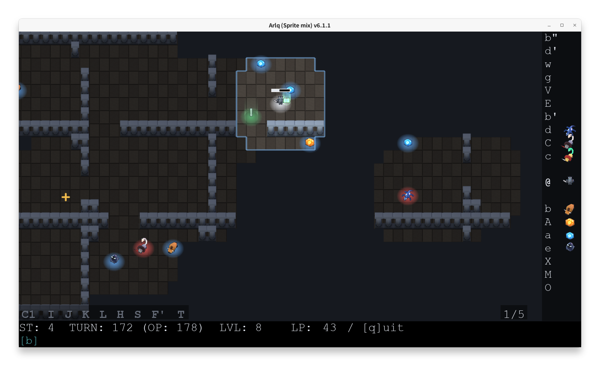
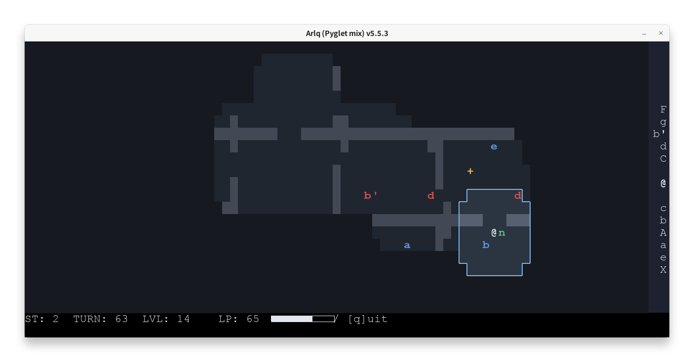
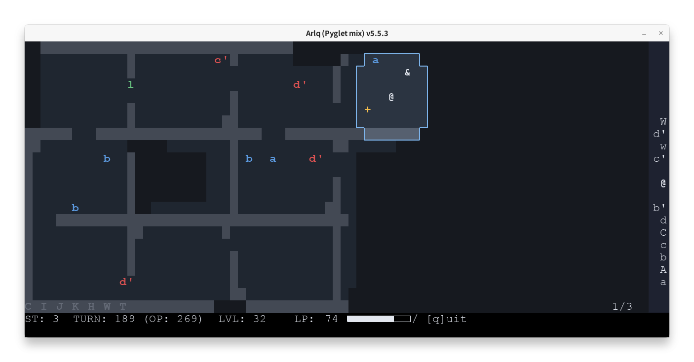
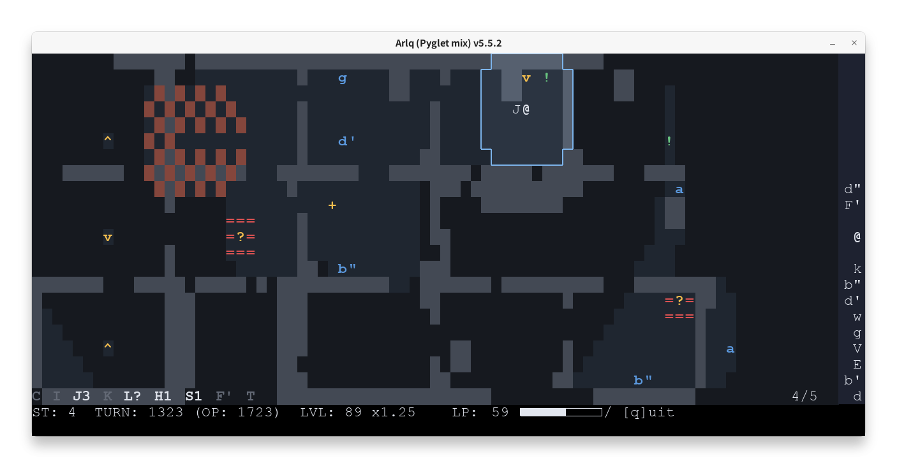
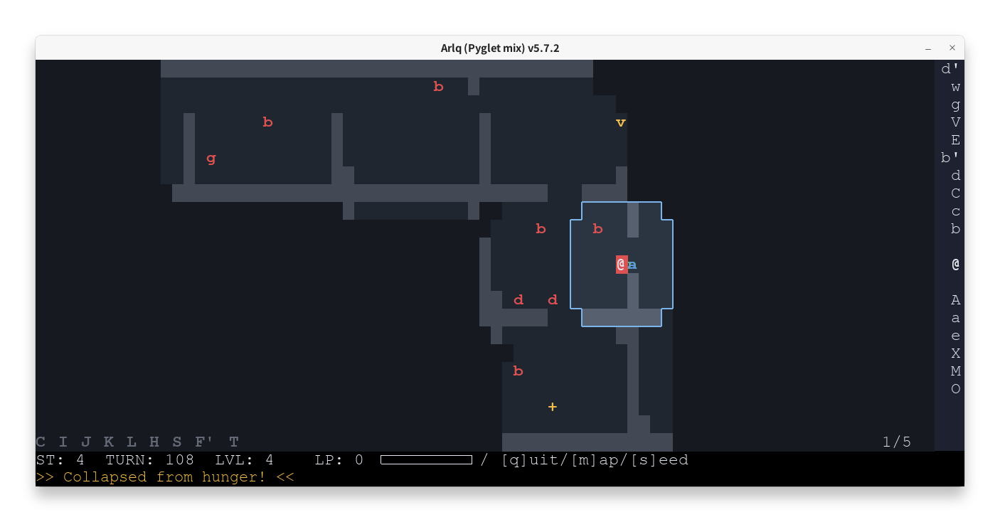

# ARLQ, another rogue-like quest game

ARLQ（Another Rogue-Like Quest）は、人間とAIsが共同で作成した実験的なローグライクゲームです。PygletとBlessed端末UIに対応したPython実装です。

<p align="center">
  <a href="https://pypi.org/project/arlq/">
    
  </a>
  <a href="https://www.python.org/">
    
  </a>
</p>



<a href="docs/images/screenshot2.png"></a>
<a href="docs/images/screenshot3.png"></a>
<a href="docs/images/screenshot4.png"></a>
<a href="docs/images/screenshot5.png"></a>

## インストールと起動

Python 3.10以降が必要です。リリース版は以下のコマンドでインストールできます。

```bash
pipx install arlq
```

GitHub上の最新版を直接インストールする場合は、以下を実行してください。

```bash
pipx install git+https://github.com/tos-kamiya/arlq
```

必要なPygletとBlessedも自動的にインストールされます。
インストール後、`arlq`、`arlq-sprites`、`arlq-cli` を実行できます。

```bash
arlq
arlq-sprites
arlq-cli
```

オプションなしで `arlq` を実行するとGUI版が起動し、`arlq-cli` を実行すると端末版が起動します。
敵と接触すると、直前に遭遇した敵パーティーの構成が`[aaw]`のようにメッセージ欄の左側に表示されます。
一時的な効果ポップアップはプレイヤーの近くに、イベントメッセージは画面下部に表示されるため、両方を同時に確認できます。
効果ポップアップのLP・LVLの増減は小数点以下1桁までに丸め、末尾の `.0` は省略します。

`arlq-sprites`（または `arlq --sprites`）でキャラクタースプライト版GUIを起動できます。ウィンドウは16:9程度の横長で開き、フィールドの一部をプレイヤーに合わせてスクロール表示します。ウィンドウの高さでフィールドを拡大・縮小し、その描画の細かさを一定に保ちます。下部のLP・メッセージ欄は設定したGUI倍率のサイズを保ちます。幅を変えると、フィールドと欄の表示に合わせてウィンドウの高さが調整されます。フィールドが表示幅より広いときは、カメラがプレイヤーを追い、Shift＋左右矢印キーで表示範囲を3マスずつ動かせます。スクロール範囲にはフィールド端の外側に1マス分の余白があります。

スプライト画像があるキャラクターは、正体が判明すると画像で表示します。正体が判明していないモンスター（トラップと崩落を含む）・同行者・エルフは、立体の `?`・`!`・`&` の記号が、それぞれ黄・緑・白の光の柱の中に立つ姿で表示されます。ステージ6の仲間は3種類の肌の色からランダムに選ばれます。主人公は、キメラの剣を持っている間はその剣を手に持ち、コレクターエルフの強化を受けると自分の剣の刃が青く光ります。LPゲージは、格闘ゲームのように主人公のすぐ上に表示します（ステータスの行にはLPの数値だけを表示します）。足元の円盤や仲間の光の柱で強さ・状態を示し、壁や床、階段、バリア、崩落地形も専用の絵で表示します。落とし穴の真下の階の床には、穴から落ちた岩が転がります。操作・ルール・視界・メニューは通常のPyglet版と共通です。`--scale` でGUI全体を拡大できます。Blenderが必要なのは同梱画像を再生成する場合のみです。

フィールドのマスにマウスを合わせると、そのキャラクターを足元の位置を保ったまま通常の2倍に拡大し、頭上に名称を表示します。未識別の場合は名称を表示しません。別のマスへ動かすと元の大きさに戻ります。マウスカーソルは動かすと表示され、最後の移動から3秒後に隠れます。

ダンジョン上端のキャラクターは、名称が見切れないよう下側に表示します。ホバー時の日本語名称は「キメラ(c)」のように「名称(記号)」で表示します。英語では射手を `Marksman(k)`、コモドドラゴンを `Komodo Dragon(d)` と表示します。

右側の攻撃力表示の文字はフィールドの拡大に連動しますが、下部のメッセージ・進捗文字と同じ大きさを上限とします。文字の大きさに合わせて文字欄の幅も狭くなります。

GUI版では接続したゲームパッドの十字キーまたは左スティックで移動でき、ステージ選択画面ではボタン0で決定できます。ステージ選択は `[1]`～`[6]` を横2列・縦3行で表示し、矢印キーやゲームパッドで選択、数字キーで直接決定できます。

設定 -> ゲームパッドボタン設定から、ゲームパッドのボタンの割当を変更できます。
端末版のステージ選択も横2列・縦3行で表示し、「終了」との間に1行空けます。矢印キーとEnter、または数字キーで選択できます。

端末UIを使用する場合は、端末の大きさを80桁×24行以上にしてください。端末をそれより小さくするとゲームは一時停止し、十分な大きさに戻すと再開します。

### `arlq-cli` と `arlq` 共通のオプション

| オプション | 説明 |
| --- | --- |
| `--version` | バージョンを表示する |
| `--rematch` | 前回のステージとシードを再利用する（同じ配置を再現するには他のレイアウト関連オプションも同じにする）。`--seed`とは併用できません。`--stage`は前回と同じステージを指定する場合に併用できます。 |
| `--seed VALUE` | 整数のシードまたはバージョン付きシード文字列を指定する |
| `--stage 1`、`--stage 2`、`--stage 3`、`--stage 4`、`--stage 5`、`--stage 6` | ステージを直接選択する。ステージ5はメンバー能力を試す小さなステージ、ステージ6は4フロアのボス・宝箱探索。 |
| `--lang en`、`--lang ja`、`--lang auto` | ゲーム内メッセージとステージ選択画面の言語を指定する。`auto`（既定）はロケールから自動判定する。ステータスバーの略語やアイテム名は常に英語で表示する。 |
| `--debug-show-entities` | 未発見のエンティティも表示する |

ゲーム開始時にステージとシードをユーザーのキャッシュディレクトリ内の
`arlq/last-seed` に保存します。`--rematch`だけで前回のステージを直接開始できます。
`--seed`を併用した場合、前回と異なる`--stage`を指定した場合、または保存値がない・壊れている場合はエラーになります。

#### 難易度調整オプション

| オプション | 説明 |
| --- | --- |
| `-T` / `--large-torch` | 視界を広げる |
| `-t` / `--small-torch` | 視界を狭める |
| `-n` / `--narrower-corridors` | 通路を狭くする |

### `arlq` のみで使えるオプション

| オプション | 説明 |
| --- | --- |
| `--terminal` | Blessedを使用した端末UIを起動する |
| `--scale FACTOR` | Pyglet GUIの表示倍率を変更する（`0.5`～`4.0`、例: `--scale 1.5`）。倍率はユーザーごとの設定ディレクトリに保存され、次回のGUI起動時にも自動的に使われる。ステージ選択画面の `設定` メニューからも変更できる。 |
| `--key-repeat-interval SECONDS` | GUIの移動キーリピートの開始待ち時間と間隔を設定する（`0.1`～`1.0` 秒）。`none`を指定すると無効にできる。値は次回起動用に保存され、ステージ選択画面の `設定` からも変更できる。 |
| `--auto-repeat-stop` / `--no-auto-repeat-stop` | 既知の危険箇所や遭遇後に自動リピートを停止する機能を有効・無効にする（初期設定は有効）。値は次回起動用に保存され、ステージ選択画面の `設定` からも変更できる。 |

`設定`の`戦闘エフェクトの表示時間`で、戦闘とバリアダメージのエフェクトを0、0.1、0.2、0.3、0.4、0.5秒から選べます（初期値0.3秒）。0秒ではエフェクト表示と待ち時間を省きます。選択は保存され、ターミナルモードにも適用されます。

## ゲームの説明

### 目的

ダンジョンを探索し、ステージのボスを倒して宝箱の封印を解除し、宝を手に入れます。後半のステージではエルフが攻略を助けます。

### プレイヤーとフォグ

`@`を矢印キーまたはWASDで操作します。移動するとLPが減り、0になるとゲームオーバーです。モンスターを倒すとLPが回復します。LPが40以下になると背景が黄色に、20以下では赤に変わります。視界はプレイヤーを中心に広がり、探索済みの場所はオートマップに残ります。

全ステージで、開始時は通常上限100を一時的に超えるLP120を持ち、序盤の探索に余裕があります。上限を超えている間、ゲージはマゼンタ色になります。超過分はモンスターを倒しても補充できません。敗北後の復帰ではLPを6減らした後、最低20を保証し、上限による切り下げは行いません。開始時の余剰を再付与することはありません。

移動リピート中に既知の危険へ近づくと、自動で停止します。この機能は初期設定で有効で、設定画面または`--no-auto-repeat-stop`で無効にできます。停止後は方向入力を離して押し直すと再開します。

「行き過ぎ救済」は、5ターン以内に同じ位置へ戻った場合、情報取得や遭遇などがなければ操作とLP消費を取り消します。戻り先には暗い灰色の`.`を表示します。

`F`を押すと、探索済みのフィールド上で、現在のLPで到達できるすべてのセルを淡い青で表示・非表示に切り替えます。ゲームパッドでは設定した範囲表示ボタンを押している間、または押すたびに切り替えて、同じ範囲を表示できます。
表示中に上下を入力すると、ステージ3・4の別フロアを確認できます。キーボードでは移動すると表示を閉じます。

到達できるセルの計算は次のルールに従います。

- 未探索セルは表示せず、経路も表示しません。
- マップ上に表示されているエンティティや階段を避け、壁破壊やLP回復は計算に含めません。
- マークスマンによるダメージは考慮しないため、実際の到達範囲と異なる場合があります。

### モンスター・同行者・エルフ

未遭遇のモンスターは `?`、同行者は `!`、正体が判明していないエルフは `&` と表示されます。接触すると種類が判明します。

モンスターの種類の判別はフロアをまたいで保持されます。一方、同行者の種類は全ステージでフロアごとに判別されるため、新しいフロアでは未遭遇の同行者が再び `!` と表示されます。

`arlq` と `arlq-cli` の右側の攻撃力表示では、判別済みのモンスターを白、未判別のモンスターを灰色で表示します。

通常のモンスターに接触すると戦闘になり、敵のレベルが自分の現在の攻撃力以下なら勝利します。通常はレベルが1上がりLPが回復しますが、LPを回復しない敵や、LP・レベルを減らす敵もいます。勝利した位置が次のチェックポイントになります。強いモンスターに敗北するとチェックポイントへ戻り、所持アイテムを失います。他のモンスターに接触せず同じモンスターに連続で2回敗北すると、マップ上のランダムな位置へ移動します。階段や落下によるフロア移動でもチェックポイントが更新されます。

通常のモンスターを倒すと、相手が何も持っていなくても所持アイテムが置き換わります。毒や胞子もこの方法で解除できます。ステージ3・4で未面会のエルフに接触すると胞子が解除され、ライフブリンガーは毒も解除します。

モンスターの中には、 `d` のように、リスポーンするものもいます。また、ステージのボス敵であるモンスターを倒すと宝箱の封印が解除されます。解錠された `T` に接触するとクリアです。

同行者は一定期間、固有の能力を提供し、一時的な同行者は一度に1体だけ連れられます。モンスターとの戦闘接触1回につき期間を1単位消費します。パーティー戦は敵の数にかかわらず1回として数えます。ペガサスのジャンプでも1単位消費します。例えば、ノミコンは視界内のモンスターとエルフの正体を明らかにします。

エルフの多くはステージ3以降に登場し、プレイヤーが一定の条件を満たすと、攻撃力強化などのサポートを与えます。

### モンスターのレアタイプと強化個体

一部のモンスターには、通常個体とは異なる特徴を持つレアな個体が存在します。例えば `A`（レアアメーバ）は大幅にレベルアップでき、`C`（レアキメラ）は攻撃力を大きく高める呪われた剣を与えます。一方、`E`（レアエレボス）はプレイヤーのレベルを減らします。

一方、ステージ2以降には強化個体も登場します。強化個体はレアタイプとは異なり、プレイヤーにとっての恩恵ではなく、通常個体より強い敵です。rank 2の強さは通常レベル×3+10、rank 3はその3倍です。画面ではrank 2を `b'`、rank 3を `b"` のように表示し、それぞれ通常個体とは別の種類として判別されます。

### パーティーメンバー

ステージ5・6では、固有の能力で戦闘や探索を助けるパーティーメンバーを最大2人まで仲間にできます。

## 同行者一覧

| 表示・名前 | 能力 |
| --- | --- |
| **l** ループ同行者 | ステージ3〜6に登場する。接触すると最大80ターン巻き戻す（経過ターン数が短い場合は開始時点まで）。探索済みマップ、判別済みの敵の種類、判明したエルフやメンバーの居場所は保持される。探索情報はヴォルテックスによる既知範囲の消去も含め、巻き戻し直前の状態を引き継ぐ。巻き戻し後10ターンは、失われた未来で通った経路を水色の「.」で表示する。 |
| **n** ノミコン | 視界内にいる活動中のモンスターとエルフの種類を判別する。 |
| **o** オキュラー | 視界を大幅に広げる。 |
| **p** ペガサス | ステージ2以降に登場する。壁を越えて移動できる。 |

## ステージ一覧

### ステージ1: 最初のダンジョン

| 表示・名前 | 説明 |
| --- | --- |
| **a** アメーバ | 最初から倒せる弱い敵。レベルアップに役立つ。 |
| **A** レアアメーバ | 倒すと通常の1ではなく、レベルが10上がる。 |
| **b** バイソン | 倒すとLPを大きく回復する。 |
| **c** キメラ | 剣を持ち、攻撃力が1.5倍になる。壁を3回まで壊せる。 |
| **d** コモドドラゴン | 強力でLPを回復するが、毒を残し、攻撃力が1/3（端数切り上げ）になる。 |
| **D** 竜 | 竜の宝箱を解錠する。 |

### ステージ2: フルサイズダンジョン

ステージ1の竜以外のモンスター・同行者に加えて、次の敵が登場します。

ステージ2には強化個体のバイソン（`b'`）も登場します。ステージ6にはバイソン（`b`）に加えてバッファロー（`B`）も登場します。

| 表示・名前 | 説明 |
| --- | --- |
| **C** レアキメラ | 呪われた剣で攻撃力が3倍になる。モンスター・エルフへの接触時と壁を壊すたびに追加でLPを10消費する。通常の剣と同様に壁を3回まで壊せる。 |
| **e** エレボス | 戦闘時にLPを少し奪う。 |
| **F** 火竜 | 火竜の宝箱を解錠する。 |
| **g** ゴーレム | 倒すとプレイヤーの斜め4方向にそれぞれ2マス先まで岩が飛び散り、食料は得られない。 |
| **H** ハイエルフ | ステージ2では受動的なエルフ。接触すると正体が判明するが、戦闘や報酬はない。 |
| **X** まきびし植物 | 接触したセルを中心に、周囲へまきびしを市松模様に撒く。接触位置によらず模様は同じ。 |

再出現待ちの処理は65ターン周期で行われます。レアエレボス（`E`）と大渦（`V`）はステージ4のランダムな階に再出現します。まきびし植物（`X`）はステージ2・3・4に登場し、ランダムなフロアに再出現します（ステージ2は1フロア）。

### ステージ3: エルフのいるダンジョン

ステージ3は3つのフロアで構成され、エルフ（`I`、`J`、`K`、`H`）が登場します。バイソン、キメラ、コモドドラゴンの強化個体（`b'`、`c'`、`d'`）も現れます。

画面には現在のフロアとエルフの進捗が表示されます。GUI版はShift＋上／下キー、`arlq-cli`はShift＋W／Sキーで別のフロアを確認できます。未探索の場所は隠れたままです。移動するとプレイヤーのいるフロア表示に戻ります。

#### モンスター

| 表示・名前 | 説明 |
| --- | --- |
| **m** 胞子モンスター | 倒すと胞子を浴び、視界が狭まる。 |
| **w** ウィルム | バリアに守られている。 |
| **W** ドレッドウィルム | バリアに守られており、討伐すると宝物庫が開く。 |

#### エルフ

| 表示・名前 | 説明 |
| --- | --- |
| **I** 隠者エルフ | 他のエルフに関する情報を伝える。壁で閉じた部屋にいる（剣で壁を壊す、ペガサスで飛び込む、階段や崩落で入るなどの手段が必要となる）。2回以降の接触ではプレイヤーをマップ上のランダムな位置に移動させる。 |
| **J** ジャベリンエルフ | プレイヤーに同行し、攻撃力を25%高める。 |
| **K** コレクターエルフ | レアキメラ（`C`）を倒した後に会うと、恒久的な攻撃力1.2倍の強化を与え、現在の所持アイテムを解除する。呪われた剣を持ち続けている必要はない。この強化では壁を壊せない。 |
| **H** ハイエルフ | `I`、`J`、`K`、`L`、`S` のうち2名以上の助力を得ると護身のアミュレットを授ける（ステージ3に登場するのは `I`、`J`、`K`）。 |

ハイエルフ(H)とコレクターエルフ(K)は、条件を満たしていない状態で接触すると、初回はメッセージを表示するだけですが、2回目以降はマップ上のランダムな位置へ移動させられます。

バリア（`=`）に入ると追加でLPを30消費します。護身のアミュレットがあればこの消費を防げますが、呪われた剣を所持している間は防げません。コレクターとジャベリンの攻撃力補正は、剣や毒などの補正に重ねて適用されます。

### ステージ4: 深い迷宮

ステージ4は5つのフロアで構成され、ステージ3に加えて新しいエルフ、モンスター、トラップが登場します。ボスは強火龍（`F'`）です。

#### モンスター

| 表示・名前 | 説明 |
| --- | --- |
| **E** レアエレボス | 倒すとプレイヤーのレベルが2/3（端数切り捨て、最低1）になる。 |
| **k** マークスマン | 水平または垂直方向に矢を撃ち、命中するとLPを4奪う。ただし、隣接したセルには撃たない。壁、階段、同行者、待機中のパーティーメンバー、宝箱、活動中のモンスターは矢を遮るが、まきびし（`x`）、崩落地形（`O`）、バリアは遮らない。撃破後は195ターン周期で再出現する。 |

#### トラップ

トラップは、宝箱に偽装したりフィールドを変化させたりする特殊能力を持つモンスターです。

未発見のトラップはモンスターと同様に `?` と表示されます。ただし、ミミックのみは宝箱と同じタイミング、文字で出現します。

| 表示・名前 | 説明 |
| --- | --- |
| **T** ミミック | ステージボスを倒すと宝箱と同じ姿で現れる。レベルは1で、倒すとプレイヤーは同じフロア内のランダムな位置へ移動する。 |
| **?** / **O** 崩落 | `?`のセルに入ると、壁のあるセルを除く上下左右に落とし穴（`O`）が現れる。次のムーブで穴に入ると、下のフロアへ落ちる。倒すと`?`は消え、リスポーンしない。 |
| **V** 大渦 | 倒すと一定の範囲のモンスター、同行者、宝箱が再配置され、その範囲の地図の記憶が奪われる。奪われた地図の記憶は、ループ同行者で巻き戻しても戻らない。 |

#### エルフ

| 表示・名前 | 説明 |
| --- | --- |
| **L** ライフブリンガーエルフ | 会うたびに毒を解除し、LPの恒久上限を5上げる（最大120）。LPは毎回120まで回復する。その後は一度消え、次の65ターン周期の再出現処理でランダムなフロアに戻る。 |
| **S** シルヴァンエルフ | 妖精の蜜を授ける。以後に仲間にした`l`以外の同行者は、効果期間が1.25倍になる。 |

### ステージ5: 訓練場

ステージ5は、敵のパーティとステージ6の仲間6人の能力を試す固定マップの訓練場です。

### ステージ6: パーティーで挑むダンジョン

ステージ6は初期レベル1の4フロアのダンジョンです。プレイヤーはパーティーメンバーを連れて戦い、モンスターもパーティーを組みます。1〜3階でパーティーメンバーを探し、4階のドレッドウィルム（`W`）を倒して宝箱を取るとクリアです。6職業のうち4人が登場し、発見した職業と階はHUDに表示されます。パーティーメンバーは最大2人で、3人目が加入すると最初のパーティーメンバーが脱退します。

各階では、最上段・最下段の左端から1列おきの計6区画を候補とし、独立区画と壁で埋まる区画を除いてシャッフルした区画に、最初にパーティーを配置します。既存の出現枠からb′、b、B、a（a′を含む）の優先順で最大6組を選び、残りは通常どおり配置します。

#### パーティーメンバー

| 表示・職業 | 能力 |
| --- | --- |
| **J** ジェスター | 分配後の経験値を1.5倍にする。 |
| **H** ヒーラー | 移動時のLP消費を半分にし、敗北時のLP消費を2にする。巻き戻し時にも反映される。 |
| **R** ならず者 | 視界内のトラップ系モンスター（`M`、`g`、`X`、`E`）を判別し、崩落の穴を開く。ゴーレムの壁を壊し、穴とレアエレボスを警告してキーリピートを停止する（現在の移動は続行）。各マークスマンの奇数回目の矢を無効にする。 |
| **K** 騎士 | レベル50で加入し、ジェスター補正前のプレイヤーの分配経験値の半分を得る。Kのレベルをプレイヤーの攻撃力に加算する。 |
| **D** ダンジョン探検家 | 探索済みの領域で落とし穴の上り口（緑の`^`）と隠し通路（`.`）を発見する。上り口から穴へ上がり、次の移動で穴から離れられる。スプライト表示では、発見済みの隠し通路を `.` の代わりに床の緑の光で示す。脱退後も発見済みの通路は使えるが、上り口の利用にはDが必要で、スプライト表示の緑の円もDがいる間だけ表示される。 |
| **G** 守護騎士 | バリアの追加ダメージとまきびしのダメージを1/3にする。 |

モンスターは横に隣接しないように配置され、パーティーは縦に並びます。

上下に隣接した敵は最大3体のパーティーで戦い、戦闘力と経験値を合計します。LP報酬は最大値を使います。経験値の分配ではプレイヤーとKを各1人、HとGを各0.5人、RとDを0人として数えます。Jは0.25人です。Jの倍率はプレイヤーの取り分に適用されます。

#### モンスター

| 表示・名前 | 説明 |
| --- | --- |
| **B** バッファロー | 攻撃力8。倒すとLPが80回復し、その時の恒久的な上限より5多くまで回復できる（上限100なら105）。この超過は恒久化せず、B以外のモンスターによる回復では通常上限を超えて補充されない。 |
| **f** / **f'** 火炎コブラ | 倒すと基礎経験値を3得る。強化個体の`f'`は空いている上下左右にバリアを張る。 |

4階のボスは`W`、`V`と護衛1体のパーティーで、ボスに擬態したミミックも登場します。落とし穴に落ちると下の階へ移動します。敗北時はパーティーメンバーも一緒にリスポーンします。

## 開発用コマンド

```bash
uv run -p .venv/bin/python python -m compileall src
uv run -p .venv/bin/python python -c "import arlq"
uv run -p .venv/bin/python pytest
uv run -p .venv/bin/python ruff check src
```

## 謝辞

ChatGPT、Gemini、Claude、Grokには、本ゲームの設計と実装に協力してもらいました。感謝します。

## ライセンス

本プロジェクトはBSD-2-Clauseライセンスのもとで公開されています。

ステージ選択・設定では、選択中の項目を「>」と太字で強調します。

Fキーで到達可能範囲を確認したとき、未探索領域も含めて残りLP以内に到達できるモンスター・同行者・エルフ・待機メンバーや、階段・落とし穴（O）がない場合、ゲームオーバーにするかを尋ねます。Dがいる場合は上階の落とし穴直下も出口として扱います。未活性のミミックは除外し、未発動の崩落（?）は対象に含めます。「はい」でQキーと同じ終了処理に進みます。拒否すればターンを消費せず、探索済み領域だけを示す通常のF表示に戻ります。
