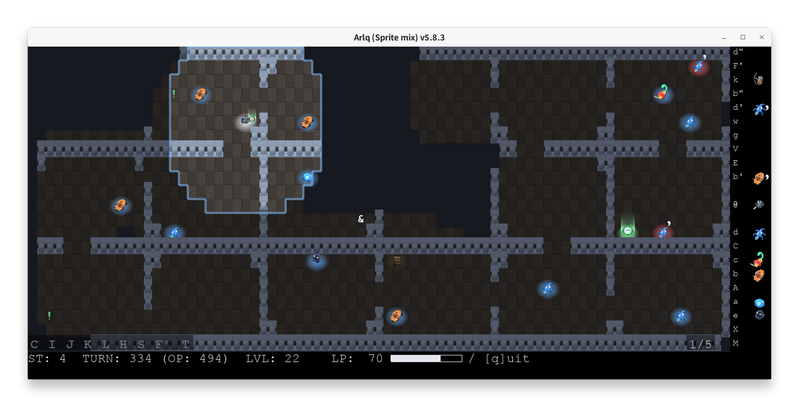
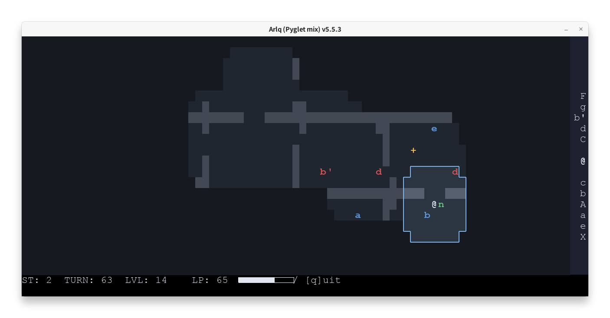
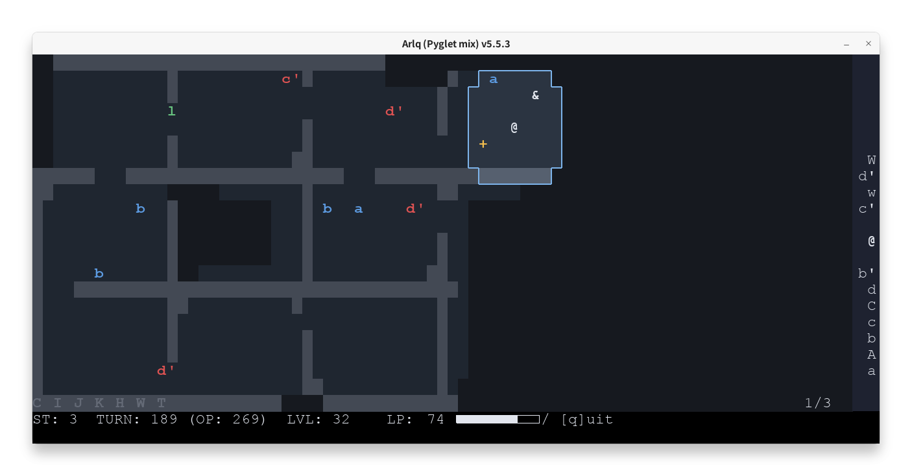
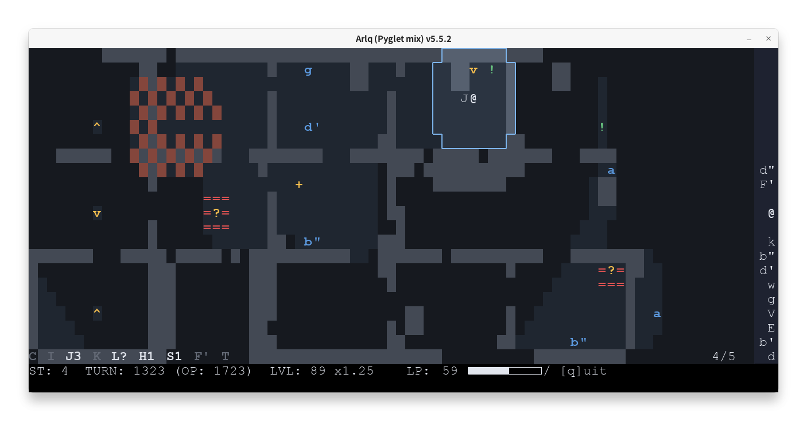
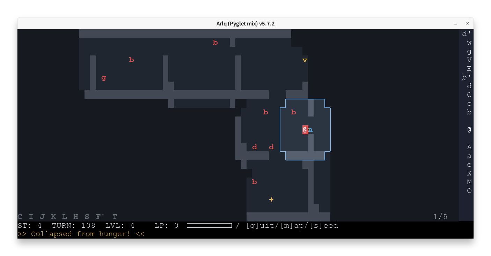

# ARLQ, another rogue-like quest game

ARLQ (Another Rogue-Like Quest) is a rogue-like game created
through collaboration between humans and AIs. This repository contains
the Python implementation with Pyglet and Blessed terminal frontends.

<p align="center">
  <a href="https://pypi.org/project/arlq/">
    
  </a>
  <a href="https://www.python.org/">
    
  </a>
</p>



<a href="docs/images/screenshot2.png"></a>
<a href="docs/images/screenshot3.png"></a>
<a href="docs/images/screenshot4.png"></a>
<a href="docs/images/screenshot5.png"></a>

## Installation Instructions

ARLQ requires Python 3.10 or later. Install the latest released version with:

```bash
pipx install arlq
```

To install the latest development version directly from GitHub instead, use:

```bash
pipx install git+https://github.com/tos-kamiya/arlq
```

The required Pyglet and Blessed dependencies are installed automatically.
Once installed, the `arlq`, `arlq-sprites`, and `arlq-cli` commands become available.

```bash
arlq
arlq-sprites
arlq-cli
```

Running `arlq` without options opens the graphical interface. Running
`arlq-cli` without options starts the terminal interface. In the GUI, use a
connected gamepad's D-pad or left stick to move, and button 0 to select a
stage. Change gamepad button assignments in `Settings -> Gamepad button settings`.

Use `arlq-sprites` for the character-sprite GUI. The same mode is also available
through `arlq --sprites`. Its window opens at about 16:9 and shows part of the
field, scrolling with the player. The window can be resized in both dimensions.
Changing the window height zooms the field while keeping its rendering detail
consistent and the HUD at the configured interface size.
The right-hand strength labels grow with the field up to the HUD text size;
their text area narrows to match smaller letters.
Changing the width adjusts the window height to fit the field
and HUD. If the field is wider than the view, the camera follows the player;
Shift+Left/Right scrolls the view without moving. The scroll range includes a
one-cell margin at each edge.

Characters with bundled sprites use transparent images once identified;
unknown characters keep their text symbols. The player is shown holding a
chimera's sword while carrying it, and its own blade glows blue after the
Collector Elf's blessing. The LP gauge floats just above the player, like a
fighting game's, instead of in the status row. Ground markers preserve strength
and status colors, and faint light pillars distinguish companions. Terrain has
a separate illustrated style, including marble walls and stairs, floor tiles,
fires, and Collapse pits; rocks fallen through a pit lie on the floor below
it.
Controls, rules, FOV and menus are shared with the original Pyglet GUI. Use
`--scale` to enlarge the GUI. Blender is only needed to regenerate the bundled
images.

The terminal interface requires a terminal at least 80 columns wide and 24
lines high. The game pauses if the terminal becomes smaller and resumes when
it is large enough again.

### Options shared by `arlq-cli` and `arlq`

| Option | Description |
| --- | --- |
| `--version` | Show the version. |
| `--rematch` | Replay the most recently started stage with the same seed. |
| `--seed VALUE` | Select an integer seed or a versioned seed string. |
| `--stage 1`, `--stage 2`, `--stage 3`, `--stage 4` | Select a stage directly. |
| `--lang en`, `--lang ja`, `--lang auto` | Choose the language of in-game messages and the stage-select screen. `auto` detects it from the locale. Status-bar labels and item names stay in English. |
| `--debug-show-entities` | Show undiscovered entities. |

At game start, the stage and seed are saved to `arlq/last-seed` under the user
cache directory. `--rematch` starts the saved stage without showing the stage
selector. It cannot be combined with `--seed`. You may also specify `--stage`
if it matches the saved stage. Keep the other layout options unchanged to
reproduce the same layout.

#### Difficulty options

| Option | Description |
| --- | --- |
| `-T` / `--large-torch` | Expand the visible area. |
| `-t` / `--small-torch` | Reduce the visible area. |
| `-n` / `--narrower-corridors` | Make corridors narrower. |

### Options available only with `arlq`

| Option | Description |
| --- | --- |
| `--terminal` | Run the game in the terminal using Blessed. |
| `--scale FACTOR` | Enlarge or reduce the Pyglet GUI (from `0.5` to `4.0`, for example `--scale 1.5`). The selected scale is saved in the per-user configuration directory and used automatically on the next GUI launch. You can also change it in the stage selection screen's `Settings`. |
| `--key-repeat-interval SECONDS` | Set the GUI movement repeat delay and interval (from `0.1` to `1.0` seconds), or use `none` to disable it. The setting is saved for later GUI starts and can also be changed in the stage selection screen's `Settings`. |
| `--auto-repeat-stop` / `--no-auto-repeat-stop` | Enable or disable automatic repeat stopping near known hazards and after encounters. Enabled by default; the selection is saved for later GUI starts and can also be changed in `Settings`. |

## Game Description

* **Objective**  
  Explore the dungeon, defeat the stage boss to unlock its treasure chest, and claim the treasure. Elves can help in the later stages.

* **Player and Fog**  
  You control the character represented by `@` using the arrow keys or WASD.

  Each move uses LP; reaching zero ends the game. Defeating monsters restores LP. The background behind `@` turns yellow at 40 LP or below and red at 20 LP or below. Your vision is centered on your location, and explored areas remain visible on the automap.

  Every stage starts with 120 LP, temporarily above the normal maximum of 100, to give you more time to explore. The gauge is magenta while LP exceeds its maximum. Defeating monsters cannot replenish the excess. Returning after a defeat subtracts 6 LP, then guarantees a minimum of 20 LP, without imposing an upper limit. This does not grant the starting bonus again.

  Holding a direction repeats movement when repeat is enabled. Automatic repeat stopping is on by default and can be changed in `Settings` or with `--no-auto-repeat-stop`. It pauses near known hazards and after encounters or special movement; release and press the direction again to resume.

  Overshoot assist cancels an accidental movement sequence if you return to the same position within five turns without gaining new map or monster information, encountering an entity, taking damage, or changing floors. Possible return cells are marked with a dark gray `.`.

  Press `F` to toggle a highlight on every explored-map cell reachable with your remaining LP. With a gamepad, the preview button can show it while held or toggle it on and off.

  While preview is active, press Up or Down to inspect another floor in Stages 3 and 4. Moving closes the keyboard preview.

  Reachable cells are calculated using these rules:

  - Unexplored cells remain hidden, and no route is shown.
  - The estimate avoids entities displayed on the map and stairs. It does not break walls or count LP recovery.
  - Marksman damage is not included, so the estimate may differ from the actual reachable area.

* **Monsters, Companions, and Elves**  
  Unencountered monsters are displayed as `?`, companions as `!`, and unidentified elves as `&`. Contact reveals an entity's type.

  Monster identification persists across floors. Companion identification is tracked separately on each floor in every stage, so an unencountered companion is shown again as `!` on a new floor.
  In `arlq` and `arlq-cli`, the right-hand strength column shows identified monster types in white and unidentified types in gray.

  Contact with an ordinary monster starts combat. You win if its level is at or below your current attack power. Most victories raise your level by 1 and restore LP, but some monsters give no LP or drain LP or levels instead. Each victory updates the checkpoint. Losing to a stronger monster returns you to the checkpoint and clears your held item; losing twice in a row to the same monster, without contacting another monster in between, sends you to a random location instead. Stairs and falls also update the checkpoint.

  Defeating another ordinary monster replaces your held item, even if it carries nothing. This also removes poison or Spores. In Stages 3 and 4, contact with an elf you have not yet met clears Spores; Lifebringer also cures poison.

  Some monsters, such as `d`, respawn. Defeating a stage boss unlocks its treasure chest. Contacting the unlocked `T` clears the stage.

  Companions provide a temporary benefit, with one temporary companion at a time. Defeating a monster consumes one unit of its duration, as does each Pegasus jump. For example, the Nomicon identifies nearby monsters and elves.

  Most elves appear from Stage 3 onward and provide support, such as increased attack power, when you meet certain conditions.

* **Rare Monster Types and Empowered Monsters**  
  Rare variants have different effects: `A` (Rare Amoeba) grants extra levels, `C` (Rare Chimera) gives a cursed sword, and `E` (Rare Erebus) drains levels. Empowered monsters appear from Stage 2 onward. Rank 2 has the normal level × 3 + 10; rank 3 has three times the rank-2 level. Their rank marks (`b'` and `b"`) identify them as stronger, separate monster types.

## Companion List

| Display & Name | Description                                                      |
| -------------- | ---------------------------------------------------------------- |
| **l** Loop Companion | Appears in Stages 3 and 4. Rewinds up to 80 turns, or to the start of the current history if shorter; explored maps, monster identities, and learned elf locations remain known. |
| **n** Nomicon  | Reveals the type of every active monster and elf within the player's field of vision. |
| **o** Ocular   | Significantly extends the player's field of vision.              |
| **p** Pegasus  | Appears from Stage 2 onward. Helps the player overcome walls when a collision is imminent. |

## Monster List

### Stage 1

| Display & Name      | Description                                                                                                                                                       |
| ------------------- | ----------------------------------------------------------------------------------------------------------------------------------------------------------------- |
| **a** Amoeba        | Weak enough to be defeated from the start. Useful for leveling up.                                                                                                |
| **A** Rare Amoeba   | Defeating it raises your level by 10 instead of the usual 1. |
| **b** Bison         | The second weakest. Defeating it restores a large amount of LP. Hunt it when you're hungry.                                                                       |
| **c** Chimera       | Moderately strong. It carries a sword. Taking it raises combat power to 1.5x and lets you break up to three walls.                                               |
| **d** Komodo Dragon | Powerful but dangerous. Defeating it restores a large amount of LP, but leaves you poisoned, reducing combat power to one third (rounded up) until replaced.        |
| **D** Dragon        | Very strong; defeating it unlocks a treasure chest.                                                                                                               |

### Stage 2

In addition to the monsters from Stage 1 except for Dragon, the following appear:

Stage 2 also features empowered Bison (`b'`).

| Display & Name      | Description                                                                                                             |
| ------------------- | ----------------------------------------------------------------------------------------------------------------------- |
| **C** Rare Chimera  | Its Cursed Sword gives 3x attack power. Each monster or elf contact and each wall broken costs an extra 10 LP. Like the normal sword, it can break up to three walls. |
| **e** Erebus        | Battling it drains your vitality by a small amount.                                                                     |
| **F** Fire Drake    | Extremely powerful; defeating it unseals the Fire Drake's treasure chest.                                               |
| **g** Golem         | When defeated, rocks scatter up to two tiles in each of the four diagonal directions around you. It yields no food.                                                                        |
| **H** High Elf      | In Stage 2, a passive elf: contact reveals it without combat or a reward. |
| **X** Caltrop Plant | Contacting it causes caltrops (`x`) to be scattered around you.                                                         |

Queued respawns are processed every 65 turns. Rare Erebus (`E`) and the Vortex
(`V`) can return on any Stage 4 floor. The Caltrop Plant (`X`), which appears
in Stages 2, 3, and 4, also respawns on a random floor; Stage 2 has one floor.

### Stage 3

Stage 3 has three connected floors and four elves: `I`, `J`, `K`, and `H`.
Empowered Bison, Chimeras, and Komodo Dragons (`b'`, `c'`, and `d'`) also
appear.

The HUD shows the current floor and elf progress. Use Shift+Up/Down in the GUI
or Shift+W/S in `arlq-cli` to inspect another floor. Unexplored areas remain
hidden; moving returns the display to the player's floor.

#### Monsters

| Display & Name | Description |
| -------------- | ----------- |
| **m** Spore | Defeating it gives you Spores and clouds your vision. |
| **w** Wyrm | Protected by a barrier. |
| **W** Dread Wyrm | Protected by a barrier and unlocks the treasure chest when defeated. |

#### Elves

| Display & Name | Description |
| -------------- | ----------- |
| **I** Isolated Elf | Reveals information about the other elves. It is in a sealed room, which you must enter by breaking a wall with a sword, flying in with Pegasus, or using stairs or a Collapse. On the second and later contacts, it sends the player to a random location on the map. |
| **J** Javelin Elf | Follows the player and increases attack power by 25%. |
| **K** Collector Elf | After you have defeated Rare Chimera (`C`), grants a permanent 1.2x attack enhancement and clears your held item. You need not still carry the cursed sword. The enhancement cannot break walls. |
| **H** High Elf | Grants the protective amulet after receiving help from any two of `I`, `J`, `K`, `L`, and `S` (only `I`, `J`, and `K` appear in Stage 3). |

The High Elf (`H`) and the Collector Elf (`K`) only show a message on the first contact made while their condition is unmet; any contact after that sends you to a random location on the map.

Entering a barrier (`=`) costs an extra 30 LP. The protective amulet removes
this cost unless you are holding the cursed sword. Collector and Javelin
bonuses stack with item modifiers, including swords and poison.

### Stage 4

Stage 4 has five connected floors and features elves, including some new ones. New monsters and traps also appear. The boss is the empowered Fire Drake (`F'`).

#### Monsters

| Display & Name | Description |
| -------------- | ----------- |
| **E** Rare Erebus | On defeat, reduces your level to two thirds, rounded down, with a minimum of 1. |
| **k** Marksman | Shoots arrows along a horizontal or vertical line for 4 LP damage per hit, but not from an adjacent cell. Walls, stairs, companions, treasure, and active monsters block arrows; caltrops (`x`), Collapse terrain (`O`), and barriers do not. |

#### Traps

Traps are monsters with special abilities, such as disguising themselves as treasure chests or changing the field.

Unidentified traps appear as `?`. The Mimic appears with the same timing and symbol as the treasure chest.

| Display & Name | Description |
| -------------- | ----------- |
| `T` Mimic | Appears as a treasure chest after the stage boss is defeated. It has level 1; defeating it moves the player to a random position on the same floor. |
| `?` / `O` Collapse | Entering its `?` cell reveals pits (`O`) in the four adjacent cells, except where a wall already exists. On the next move, entering a pit drops the player to the next floor. Defeating Collapse removes the `?`; it does not respawn. |
| `V` Vortex | Repositions nearby monsters, companions, and treasure chests when defeated. |

#### Elves

| Display & Name | Description |
| -------------- | ----------- |
| **L** Lifebringer Elf | Each meeting cures poison, raises your permanent LP maximum by 5, up to 120, and restores LP to 120. L then disappears and returns on a random floor at a later 65-turn respawn tick. |
| **S** Sylvan Elf | Gives you fairy nectar. Companions recruited afterward, except `l`, stay with you 1.25 times longer. |

## Development commands

```bash
uv run -p .venv/bin/python python -m compileall src
uv run -p .venv/bin/python python -c "import arlq"
uv run -p .venv/bin/python pytest
uv run -p .venv/bin/python ruff check src
```

## Acknowledgments

ChatGPT, Gemini, Claude, and Grok contributed to the design and implementation of this game. Their assistance is gratefully acknowledged.

## License

This project is licensed under the BSD-2 license.
