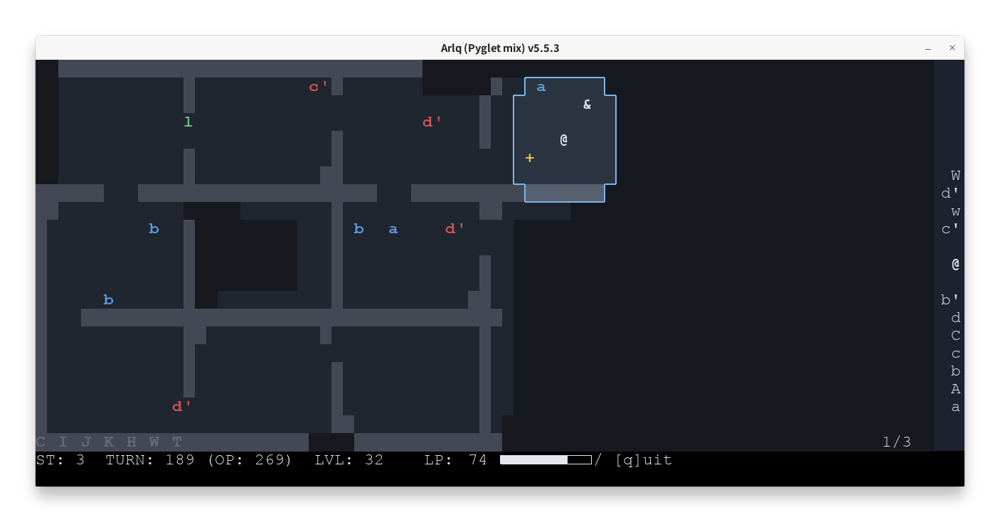
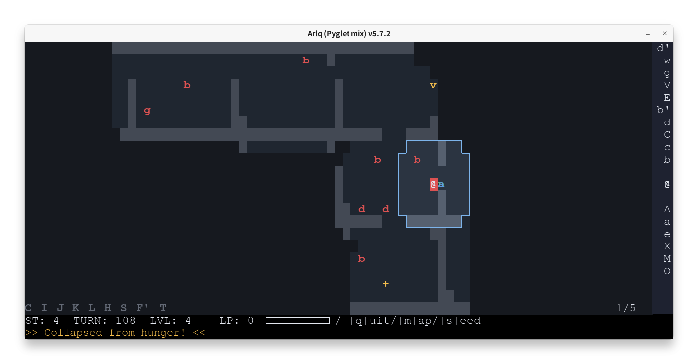

# ARLQ, another rogue-like quest game

ARLQ (Another Rogue-Like Quest) is a rogue-like game created
through collaboration between humans and AIs. This repository contains
the Python implementation with Pyglet and Blessed terminal frontends.

<p align="center">
  <a href="https://pypi.org/project/arlq/">
    
  </a>
  <a href="https://www.python.org/">
    
  </a>
</p>


<a href="docs/images/screenshot2.png"></a>
<a href="docs/images/screenshot3.png"></a>
<a href="docs/images/screenshot4.png"></a>
<a href="docs/images/screenshot5.png"></a>

## Installation Instructions

ARLQ requires Python 3.10 or later. Install the latest released version with:

```bash
pipx install arlq
```

To install the latest development version directly from GitHub instead, use:

```bash
pipx install git+https://github.com/tos-kamiya/arlq
```

The required Pyglet and Blessed dependencies are installed automatically.
Once installed, the `arlq`, `arlq-sprites`, and `arlq-cli` commands become available.

```bash
arlq
arlq-sprites
arlq-cli
```

## Command-line options

### Options shared by `arlq-cli`, `arlq`, and `arlq-sprites`

| Option | Description |
| --- | --- |
| `--version` | Show the version. |
| `--rematch` | Replay the most recently started stage with the same seed. |
| `--seed VALUE` | Select an integer seed or a versioned seed string. |
| `--stage 1`, `--stage 2`, `--stage 3`, `--stage 4`, `--stage 5`, `--stage 6` | Select a stage directly. Stage 5 is a compact member-ability trial; Stage 6 is a three-floor boss and treasure dungeon. |
| `--lang en`, `--lang ja`, `--lang auto` | Choose the language of in-game messages and the stage-select screen. `auto` detects it from the locale. Status-bar labels and item names stay in English. |
| `--debug-show-entities` | Show undiscovered entities. |

At game start, the stage and seed are saved to `arlq/last-seed` under the user
cache directory. `--rematch` starts the saved stage without showing the stage
selector. It cannot be combined with `--seed`. You may also specify `--stage`
if it matches the saved stage. Keep the other layout options unchanged to
reproduce the same layout.

The game uses its own MT19937 generator, so the same game version, seed, and
options reproduce layouts across Python versions. The switch from the previous
generator changes layouts and means older recorded traces may not replay correctly.
Integer seeds use their low 32 bits.

#### Difficulty options

| Option | Description |
| --- | --- |
| `-T` / `--large-torch` | Expand the visible area. |
| `-t` / `--small-torch` | Reduce the visible area. |

### Options available only with `arlq`

| Option | Description |
| --- | --- |
| `--terminal` | Run the game in the terminal using Blessed. |
| `--scale FACTOR` | Enlarge or reduce the Pyglet GUI (from `0.5` to `4.0`, for example `--scale 1.5`). The selected scale is saved in the per-user configuration directory and used automatically on the next GUI launch. You can also change it in the stage selection screen's `Settings`. |
| `--key-repeat-interval SECONDS` | Set the GUI movement repeat delay and interval (from `0.1` to `1.0` seconds), or use `none` to disable it. The setting is saved for later GUI starts and can also be changed in the stage selection screen's `Settings`. |
| `--auto-repeat-stop` / `--no-auto-repeat-stop` | Enable or disable automatic repeat stopping near known hazards and after encounters. Enabled by default; the selection is saved for later GUI starts and can also be changed in `Settings`. |

In `Settings`, `Combat effect duration` selects 0, 0.1, 0.2, 0.3, 0.4, or 0.5 seconds for combat and barrier damage effects (default: 0.3). Choosing 0 disables the effects and their delay. The selection is saved and also used in terminal mode.
In `arlq-sprites`, `Floor transition duration` selects 0 to 1 second in 0.1-second steps for the still shown between floors (default: 0.5; 0 skips it).

## Screen and controls

`arlq-cli` runs in a terminal, `arlq` opens a character-based GUI, and
`arlq-sprites` opens a GUI with character sprites.

### Common to all modes

The stage selector arranges `[1]` through `[6]` in two columns and three rows;
select a stage directly with a number key. GUI modes also support gamepads;
button assignments can be changed in `Settings -> Gamepad button settings`.

Control the player character (`@` in `arlq-cli` and `arlq`) using the arrow keys or WASD.
Your vision is centered on your location, and explored areas remain visible on the automap.

After contacting an enemy, its party composition remains in brackets to the
left of event messages. Temporary status popups appear near the player, while
event messages remain in the bottom status area. LP and LVL changes in the
popups are rounded to one decimal place, omitting trailing `.0`.

### Terminal: `arlq-cli`

The Blessed terminal interface requires at least 80 columns and 24 lines. The
game pauses if the terminal becomes smaller and resumes when it is large enough
again. `arlq --terminal` also starts the terminal interface.

### Sprite GUI: `arlq-sprites`

Use `arlq-sprites` for the character-sprite GUI. The same mode is also available
through `arlq --sprites`. Its window opens at about 16:9 and shows part of the
field, scrolling with the player. The window can be resized in both dimensions.
Changing the window height zooms the field while keeping its rendering detail
consistent.
If the field is wider than the view, the camera follows the player;
Shift+Left/Right scrolls the view three cells at a time without moving.

The player is shown holding a sword when carrying one. The LP gauge appears just above the player, as in a fighting game. Ground discs show whether monsters are identified, their strength, and the player's status.

Hover over a character to enlarge it and display its name. Unidentified characters show no name.

## Game Description

* **Objective**  
  Explore the dungeon, defeat the stage boss to unlock its treasure chest, and claim the treasure. Elves can help in the later stages.

  LP represents the player's life and decreases with movement or damage; reaching zero ends the game. Defeating monsters restores LP. The background behind `@` turns yellow at 40 LP or below and red at 20 LP or below.

  Level represents the player's strength. Defeating monsters grants experience, which is added to the player's level.

  Every stage starts with 120 LP, temporarily above the normal maximum of 100, to give you more time to explore. The gauge is magenta while LP exceeds its maximum. Defeating monsters cannot replenish the excess. Returning after a defeat subtracts 6 LP, then guarantees a minimum of 20 LP, without imposing an upper limit. This does not grant the starting bonus again.

* **Player Support Features**

  | Feature | Description |
  | --- | --- |
  | Movement repeat | Holding a direction repeats movement when enabled. Automatic stopping is on by default near known hazards and after encounters or special movement; release and press the direction again to resume. Change it in `Settings` or with `--no-auto-repeat-stop`. |
  | Reachable area preview | Press `F` to highlight explored cells reachable with your remaining LP. A gamepad button can show the preview while held or toggle it. While viewing the preview, Up or Down inspects another floor in Stages 3 and 4; moving closes the keyboard preview. Unexplored cells and routes remain hidden. The estimate avoids displayed entities and stairs, does not break walls or count LP recovery, and excludes Marksman and Ivy damage, so actual reach may differ. |

* **Monsters, Fairies, and Elves**

  Unencountered monsters are displayed as `?`, fairies as `!`, and unidentified elves as `&`. Contact reveals an entity's type. The rank 1 Amoeba (`a`) is known from the start of every stage; stronger ranks are identified separately.

  Monster identification persists across floors. Fairy identification is tracked separately on each floor in every stage, so an unencountered fairy is shown again as `!` on a new floor.
  In `arlq` and `arlq-cli`, the right-hand strength column shows identified monster types in white and unidentified types in gray.

  Contact with an ordinary monster starts combat. You win if its level is at or below your current attack power. Most victories raise your level by 1 and restore LP, but some monsters give no LP or drain LP or levels instead. Each victory updates the checkpoint. Losing to a stronger monster returns you to the checkpoint and clears your held item; losing twice in a row to the same monster, without contacting another monster in between, sends you to a random location instead. Stairs and falls also update the checkpoint.

  Defeating another ordinary monster replaces your held item, even if it carries nothing. This also removes poison or Spores. In Stages 3 and 4, contact with an elf you have not yet met clears Spores; Lifebringer also cures poison.

  Some monsters, such as `d`, respawn. Monster spawns and respawns avoid the 5×5 cells centered on the player on the current floor. If no position is available, that attempt is skipped. Defeating a stage boss unlocks its treasure chest. Contacting the unlocked `T` clears the stage.

  Fairies provide a temporary benefit, with one fairy at a time. Each monster combat encounter consumes one unit of its duration; a party encounter counts once regardless of its size. Each Pegasus jump also consumes one unit. For example, the Nomicon identifies nearby monsters and elves.

  Most elves appear from Stage 3 onward and provide support, such as increased attack power, when you meet certain conditions.

* **Rare Monster Types and Empowered Monsters**  
  Rare variants have different effects: `A` (Rare Amoeba) grants extra levels, `C` (Rare Chimera) gives a cursed sword, and `E` (Rare Erebus) drains levels. Empowered monsters appear from Stage 2 onward. Rank 2 has the normal level × 3 + 10; rank 3 has three times the rank-2 level. Their rank marks (`b'` and `b"`) identify them as stronger, separate monster types.

* **Party Members**

  In Stages 5 and 6, you can recruit up to two party members whose abilities support combat and exploration. The first stays with you; each later recruit replaces the second member. Jester is an exception: J leaves when you reach level 80 and cannot join again. Members follow the path you take, in joining order.

## Fairy List

| Display & Name | Description                                                      |
| -------------- | ---------------------------------------------------------------- |
| **l** Loop Fairy | Appears in Stages 3–4. Rewinds up to 80 turns on contact, or to the start if fewer turns have elapsed. |
| **n** Nomicon  | Reveals the type of every active monster and elf within the player's field of vision. |
| **o** Ocular   | Significantly extends the player's field of vision.              |
| **p** Pegasus  | Appears from Stage 2 onward. Helps the player overcome walls when a collision is imminent. Barrier landings require barrier immunity or G; R clears Golem walls at the landing point. |

Note on the Loop Fairy: The destination becomes the new anchor, and subsequent rewinds cannot go earlier than that anchor, even when using a Loop Fairy on another floor. Explored maps, monster identities, and learned elf and member locations remain known. Map knowledge is carried over as it stands immediately before the rewind, including any areas erased by a Vortex. The random generator continues from its current state through the rewind, so later encounters can differ. The path from the discarded future appears as cyan dots for 10 turns after the rewind.

## Stage List

### Stage 1: The First Dungeon

| Display & Name      | Description                                                                                                                                                       |
| ------------------- | ----------------------------------------------------------------------------------------------------------------------------------------------------------------- |
| **a** Amoeba        | Weak enough to be defeated from the start. Useful for leveling up.                                                                                                |
| **A** Rare Amoeba   | Worth 10 experience instead of the usual 1. |
| **b** Bison         | The second weakest. Defeating it restores a large amount of LP. Hunt it when you're hungry.                                                                       |
| **c** Chimera       | Moderately strong. It carries a sword. Taking it raises combat power to 1.5x and lets you break up to three walls.                                               |
| **d** Komodo Dragon | Powerful but dangerous. Defeating it restores a large amount of LP, but leaves you poisoned, reducing combat power to one third (rounded up) until replaced.        |
| **D** Dragon        | Very strong; defeating it unlocks a treasure chest.                                                                                                               |

### Stage 2: Full-Size Dungeon

In addition to the monsters from Stage 1 except for Dragon, the following appear:

Stage 2 also features empowered Bison (`b'`). Stage 6 has Bison and Buffalo variants whose ranks vary by floor.

| Display & Name      | Description                                                                                                             |
| ------------------- | ----------------------------------------------------------------------------------------------------------------------- |
| **C** Rare Chimera  | Its Cursed Sword gives 3x attack power. Each monster or elf contact and each wall broken costs an extra 10 LP. Like the normal sword, it can break up to three walls. |
| **e** Erebus        | Battling it drains your vitality by a small amount.                                                                     |
| **F** Fire Drake    | Extremely powerful; defeating it unseals the Fire Drake's treasure chest.                                               |
| **g** Golem         | When defeated, rocks scatter up to two tiles in each of the four diagonal directions around you, replacing any walls, barriers, or caltrops there. It yields no food. In the character GUI and terminal, explored rubble is marked with `+`. |
| **H** High Elf      | In Stage 2, a passive elf: contact reveals it without combat or a reward. |
| **X** Caltrop Plant | Contacting it scatters caltrops (`x`) around you in a checkerboard pattern centered on the contact cell, consistent at every location. It replaces walls and barriers but not Golem rubble. Hidden passages and pit climb points are protected from caltrops, rubble, and barriers. The rank-2 form `X'` scatters them one tile farther. |

Queued respawns are processed every 65 turns. Rare Erebus (`E`) and the Vortex
(`V`) can return on any Stage 4 floor. The Caltrop Plant (`X`), which appears
in Stages 2, 3, and 4, also respawns on a random floor; Stage 2 has one floor.

### Stage 3: Dungeon with Elves

Stage 3 has three connected floors and four elves: `I`, `J`, `K`, and `H`.
Empowered Bison, Chimeras, and Komodo Dragons (`b'`, `c'`, and `d'`) also
appear.

The HUD shows the current floor and elf progress. Use Shift+Up/Down in the GUI
or Shift+W/S in `arlq-cli` to inspect another floor. Unexplored areas remain
hidden; moving returns the display to the player's floor.

#### Monsters

| Display & Name | Description |
| -------------- | ----------- |
| **m** Spore | Defeating it gives you Spores and clouds your vision. |
| **w** Wyrm | Worth 5 experience at every rank. Protected by a barrier. |
| **W** Dread Wyrm | Worth 5 experience at every rank. Protected by a barrier and unlocks the treasure chest when defeated. |

#### Elves

| Display & Name | Description |
| -------------- | ----------- |
| **I** Isolated Elf | Reveals information about the other elves. It is in a sealed room, which you must enter by breaking a wall with a sword, flying in with Pegasus, or using stairs or a Collapse. On the second and later contacts, it sends the player to a random location on the map. |
| **J** Javelin Elf | Follows the player and increases attack power by 25%. |
| **K** Collector Elf | After you have defeated Rare Chimera (`C`), grants a permanent 1.2x attack enhancement and clears your held item. You need not still carry the cursed sword. The enhancement cannot break walls. |
| **H** High Elf | Grants the protective amulet after receiving help from any two of `I`, `J`, `K`, `L`, and `S` (only `I`, `J`, and `K` appear in Stage 3). |

The High Elf (`H`) and the Collector Elf (`K`) only show a message on the first contact made while their condition is unmet; any contact after that sends you to a random location on the map.

Entering a barrier (`=`) costs an extra 30 LP. The protective amulet removes
this cost unless you are holding the cursed sword. Collector and Javelin
bonuses stack with item modifiers, including swords and poison.

In `arlq` and `arlq-cli`, barriers have a red background and black glyph when they deal 30 LP damage. With G they have a red glyph on the normal background; when the amulet prevents their damage, the glyph is dim red.

In `arlq-sprites`, barriers are drawn as orange light rising from the floor. Around the player (their own cell and the eight around it), barriers shrink to about a quarter of the area with lower light when G reduces their damage, and turn into faint grey smoke when the amulet prevents their damage.

### Stage 4: Deep Labyrinth

Stage 4 has five connected floors and features elves, including some new ones. New monsters and traps also appear. The boss is the empowered Fire Drake (`F'`).

#### Monsters

| Display & Name | Description |
| -------------- | ----------- |
| **E** Rare Erebus | On defeat, reduces your level to two thirds, rounded down, with a minimum of 1. |
| **k** Marksman | Worth 3 experience. Shoots arrows along a horizontal or vertical line for 4 LP damage per hit, but not from an adjacent cell. Walls, stairs, fairies, waiting party members, treasure, and active monsters block arrows; caltrops (`x`), Collapse terrain (`O`), and barriers do not. Respawns on a 195-turn cycle after defeat. |

#### Traps

Traps are monsters with special abilities, such as disguising themselves as treasure chests or changing the field.

Unidentified traps appear as `?`. The Mimic appears with the same timing and symbol as the treasure chest.

| Display & Name | Description |
| -------------- | ----------- |
| **T** Mimic | Appears as a treasure chest after the stage boss is defeated. It has level 1; defeating it moves the player to a random position on the same floor. |
| **?** / **O** Collapse | When a Rogue is in the party and its `?` cell enters the field of view, pits (`O`) open in the four adjacent cells, except where a wall already exists. Otherwise, entering its `?` cell opens the pits. On the next move, entering a pit drops the player to the next floor. Defeating Collapse removes the `?`; it does not respawn. |
| **V** Vortex | Repositions nearby monsters, fairies, and treasure chests when defeated, and erases map memory in the affected area. Collapses remain in place. Map memory lost to a Vortex is not restored by the Loop Fairy's rewind. |

#### Elves

| Display & Name | Description |
| -------------- | ----------- |
| **L** Lifebringer Elf | Each meeting cures poison, raises your permanent LP maximum by 5, up to 120, and restores LP to 120. L then disappears and returns on a random floor at a later 65-turn respawn tick. |
| **S** Sylvan Elf | Gives you fairy nectar. Fairies recruited afterward, except `l`, stay with you 1.25 times longer. |

### Stage 5: Training Ground

Stage 5 is a fixed-map training ground for trying enemy parties and the abilities of six Stage 6 party members (excluding the Yawning Cat and Fairy Seer).

### Stage 6: Dungeon with a Party

Ordinary openings between sections are one cell wider than in the other generated stages; hidden passages remain one cell wide.

Stage 6 is a three-floor dungeon starting at level 1. Recruit party members near the bridgehead and face monsters that also form parties. Returning to the floor 1 bridgehead restores LP to 50 if it is lower. Defeat the empowered Fire Drake (`F'`) on the final floor and claim the treasure.

When you use a different staircase or pit from the one used for your previous floor change, all unrecruited members are scattered independently to random floors, and their previously known locations are cleared. Reusing the same staircase or pit consecutively, in either direction, does not scatter them again.

Each floor starts with a sword-carrying `c` and three fairies selected from `l`, `n`, `o`, and `p`. A fairy that leaves returns only to its original floor. The dungeon then makes 40, 35, and 30 monster spawn attempts on floors 1, 2, and 3 respectively. Initial spawns on floor 1 use random positions; floors 2 and 3 use the same party preference as later spawns. Every 20 turns, a spawn is attempted on each floor. Solo monsters do not move on their own. Stronger types appear on deeper floors. Spore monsters (`m`) can appear on every floor; Rare Erebus (`E`) can appear on floor 2. Defeated monsters do not respawn. Use the sword from `c` to shape passages and reach the boss before monsters accumulate.

#### Party members

| Display & Profession | Ability |
| --- | --- |
| **J** Jester | Multiplies your experience by 1.5, leaves when your level reaches 80, and cannot join afterward. |
| **H** Healer | Reduces movement LP cost to three-quarters and the defeat cost to 3. |
| **R** Rogue | Identifies trap-type monsters (`M`, `g`, `X`, `E`) in view and opens Collapse pits. Breaks Golem walls and warns about pits and Rare Erebus, stopping key repeat after the current move. Negates each Marksman's odd-numbered shots. |
| **K** Knight | Adds a fixed 40 to your attack power. |
| **D** Dungeon Explorer | Lets you climb pits using a rope and travel through hidden passages. These are shown with green characters or light. |
| **G** Guardian | Greatly reduces barrier damage. |
| **S** Fairy Seer | While in the party, identifies fairies in explored areas on every floor. |
| **Y** Yawning Cat | Patrols independently and reveals information a short distance away. |

Monsters spawn individually and form parties when vertically adjacent. Ordinary spawns avoid the starting section and otherwise use the same rates across sections, including the boss section. Normal monsters can join the boss party, up to the eight-member limit. When party preference applies, normal monsters have a 45% chance to try up to five positions above or below existing monsters, followed by up to five random positions if needed. Otherwise, up to ten random positions are tried. If none is valid, the spawn is skipped. Monsters can spawn on barrier cells, removing the barrier from that cell. Monsters with special effects spawn alone.

Vertically adjacent monsters fight in parties of up to eight, combining their strength and experience; the highest LP reward applies. The player receives the monsters' combined experience.

If a defeated party contains a sword-bearing `c`, its sword takes precedence over other members' items, including spores.

Some rooms may be sealed by walls, but D can discover passages into them.

#### Monsters

| Display & Name | Description |
| --- | --- |
| **B** Buffalo | Attack power 8. Defeating it restores 90 LP and can raise LP to 5 above the current permanent maximum. Other monster recovery cannot replenish LP above the normal cap. |
| **f** / **f'** Flame cobra | Worth 5 experience. `f` places barriers on available cells immediately to its left and right; the empowered form `f'` places them in all four cardinal directions. |
| **i** Ivy | Base attack power 50. Rank 1 and 2 Ivies appear on floors 2 and 3. Each active Ivy deals 4 LP damage every turn when the player is directly above, below, left, or right of it. Rogue does not block this damage. |
| **g** / **g'** Golem | Rank 1 Golems appear on every floor, and rank 2 Golems also appear on floor 3. |
| **w** / **w'** Wyrm | Floor 2 has `w`; floor 3 has both `w` and `w'`. |

The floor 3 boss party starts with `F'`, `V`, and `k` and may gain more members; a Mimic also impersonates the boss. Pits drop you to the next floor. On defeat, your members respawn with you.

## Development commands

```bash
uv run -p .venv/bin/python python -m compileall src
uv run -p .venv/bin/python python -c "import arlq"
uv run -p .venv/bin/python pytest
uv run -p .venv/bin/python ruff check src
```

## Acknowledgments

ChatGPT, Gemini, Claude, and Grok contributed to the design and implementation of this game. Their assistance is gratefully acknowledged.

## License

This project is licensed under the BSD-2 license.
