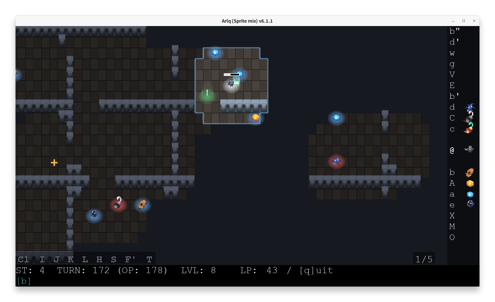
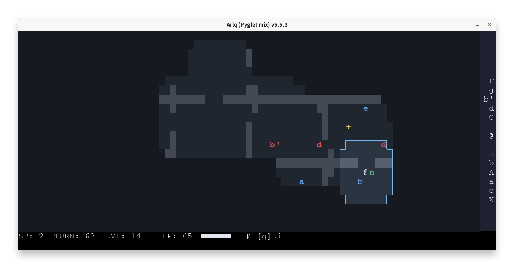
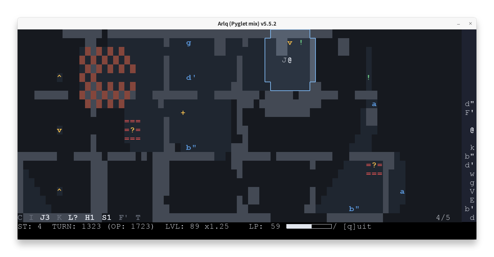

# ARLQ, another rogue-like quest game

ARLQ (Another Rogue-Like Quest) is a rogue-like game created
through collaboration between humans and AIs. This repository contains
the Python implementation with Pyglet and Blessed terminal frontends.

<p align="center">
  <a href="https://pypi.org/project/arlq/">
    
  </a>
  <a href="https://www.python.org/">
    
  </a>
</p>



<a href="docs/images/screenshot2.png"></a>
<a href="docs/images/screenshot3.png"></a>
<a href="docs/images/screenshot4.png"></a>
<a href="docs/images/screenshot5.png"></a>

## Installation Instructions

ARLQ requires Python 3.10 or later. Install the latest released version with:

```bash
pipx install arlq
```

To install the latest development version directly from GitHub instead, use:

```bash
pipx install git+https://github.com/tos-kamiya/arlq
```

The required Pyglet and Blessed dependencies are installed automatically.
Once installed, the `arlq`, `arlq-sprites`, and `arlq-cli` commands become available.

```bash
arlq
arlq-sprites
arlq-cli
```

`arlq-cli` runs in a terminal, `arlq` opens a character-based GUI, and
`arlq-sprites` opens a GUI with character sprites. `arlq --terminal` also
starts the terminal version, and `arlq --sprites` the sprite GUI version.

## Command-line options

| Option | Description |
| --- | --- |
| `--version` | Show the version. |
| `--rematch` | Replay the most recently started stage with the same seed. It cannot be combined with `--seed`. You may also specify `--stage` if it matches the saved stage. |
| `--seed VALUE` | Select an integer seed or a versioned seed string. |
| `--stage 1`, `--stage 2`, `--stage 3`, `--stage 4`, `--stage 5`, `--stage 6` | Select a stage directly. Stage 5 is a compact member-ability trial; Stage 6 is a three-floor boss and treasure dungeon with a 2,000-turn limit. |
| `--lang en`, `--lang ja`, `--lang auto` | Choose the language of in-game messages and the stage-select screen. `auto` (the default) detects it from the locale. Status-bar labels and item names stay in English. |
| `-T` / `--large-torch` | Difficulty option. Widen the field of view. |
| `-t` / `--small-torch` | Difficulty option. Narrow the field of view. |
| `--debug-show-entities` | Show undiscovered entities. |

At game start, the stage and seed are saved to `arlq/last-seed` under the user
cache directory. `--rematch` alone starts the saved stage directly. It is an
error if combined with `--seed`, if `--stage` differs from the saved stage, or if
no valid saved value exists.

The game uses its own MT19937 generator, so the same game version, seed, and
options reproduce layouts across Python versions.

## Screen and controls

Screens and controls common to `arlq-cli`, `arlq`, and `arlq-sprites`:

- The stage selector arranges `[1]` through `[6]` in two columns and three rows; select a stage directly with a number key.
- Control the player character (`@` in `arlq-cli` and `arlq`) using the arrow keys or WASD. GUI versions also support gamepads; button assignments can be changed in `Settings` → `Gamepad button settings`.
- Your vision is centered on your location, and explored areas remain visible on the automap.
- After contacting an enemy, its party composition remains in brackets, such as `[aaw]`, to the left of event messages.
- Temporary status popups appear near the player, while event messages appear at the bottom of the screen.

### Terminal version: `arlq-cli`

The terminal must be at least 80 columns by 24 lines.

### Sprite GUI version: `arlq-sprites`

**Window**: The window opens wide enough to show the complete field and strength
column without scrolling, and can be resized in both dimensions. Changing the
window height zooms the field while keeping its rendering detail consistent. If
the window is resized narrower than the field, the camera follows the player;
Shift+Left/Right scrolls the view three cells at a time.

**Player**: The player is shown holding a sword when carrying one. The LP gauge
appears just above the player, as in a fighting game. The disc under the player
shows its LP status. When LP runs out, the player sinks for a moment after its
last move and then lies collapsed on the final screen.

**Monsters**: The disc under a monster shows whether it is identified and its
strength. Hover over a character to enlarge it and display its name above it.
Unidentified characters show no name.

## Game settings

`Settings` on the stage selection screen (the `s` key) changes display and
control settings. Settings are saved in the per-user configuration directory and
used by every mode on later starts.

The items other than the gamepad ones can be given as command-line options.
However, an option is used for that run only and does not change the saved
settings. The settings screen shows the option values; applying it saves only
the items changed in the settings screen.

### Settings screen

In the settings screens, Up/Down selects an item and Left/Right changes its
value. Enter or Right opens a submenu (an item marked `->`). Enter applies the
changes and exits settings, and Esc cancels; in a submenu, Esc cancels the
submenu's changes and returns to `Settings`.

#### `Settings`

| Settings item | Command-line option | Description |
| --- | --- | --- |
| `Interface scale` | `--scale FACTOR` | GUI display scale (`0.5` to `4.0`; default `1.0`). The settings screen selects it in 25% steps. |
| `Movement repeat interval` | `--key-repeat-interval SECONDS` | GUI movement repeat delay and interval while a direction is held (`0.1` to `1.0` seconds). `none` (`No repeat`, the default) disables it. |
| `Automatic repeat stop` | `--auto-repeat-stop on\|off` | Stops held movement near known hazards and visible entities (default: On). |
| `Sprite display settings ->` | | Opens the submenu below. |
| `Gamepad button settings ->` | | Opens the submenu below. |
| `Reset all settings to defaults` | | Enter sets every setting, including those in the submenus, back to its default and exits settings. The saved settings are removed from the settings file. |

#### `Settings` → `Sprite display settings`

| Settings item | Command-line option | Description |
| --- | --- | --- |
| `Combat effect duration` | `--combat-effect-duration SECONDS` | Duration of combat and barrier damage effects (`0` to `0.5` seconds in 0.1-second steps; default `0.3`). 0 disables the effects and their delay. Used in every mode. |
| `Floor transition duration` | `--floor-transition-duration SECONDS` | Duration of the short scene `arlq-sprites` shows between floors (`0` to `1` second in 0.1-second steps; default `0.5`). 0 skips it. |
| `Character bobbing` | `--character-bobbing on\|off` | In `arlq-sprites`, makes characters in view hop slightly every 0.7 seconds while the game waits for input (default: On). |
| `Smooth movement` | `--smooth-movement on\|off` | In `arlq-sprites`, the player, its fairy, and following party members glide into each one-cell step, with the field scrolling along (default: On). When it is off, they and the view move a whole cell at once. |

#### `Settings` → `Gamepad button settings`

Gamepads work in the GUI versions (`arlq` and `arlq-sprites`). The items on this
screen have no command-line options.

| Settings item | Description |
| --- | --- |
| `Help button` | Button that shows the controls (button 0 to 12; default: button 3), or unassigned. |
| `Range / floor preview button` | Button for the range / floor preview (button 0 to 12; default: button 2), or unassigned. It cannot be the same as the help button. |
| `Range / floor preview behavior` | Whether the preview button is held or toggled (default: hold). |
| `Load default settings ->` | Right resets the three items on this screen to their defaults. |

In the GUI versions, pressing gamepad button 2 to 12 also assigns it to the selected item.

## Game Description

* **Objective**  
  Explore the dungeon, defeat the stage boss to unlock its treasure chest, and claim the treasure. Elves can help in the later stages.

  LP represents the player's life and decreases with movement or damage; reaching zero ends the game. Defeating monsters restores LP. The background behind `@` turns yellow at 40 LP or below and red at 20 LP or below.

  Level represents the player's strength. Defeating monsters grants experience, which is added to the player's level.

  Every stage starts with 120 LP, temporarily above the normal maximum of 100, to give you more time to explore. The gauge is magenta while LP exceeds its maximum. Defeating monsters cannot replenish the excess. Returning after a defeat subtracts 6 LP, then guarantees a minimum of 20 LP, without imposing an upper limit. This does not grant the starting bonus again.

* **Player Support Features**

  | Feature | Description |
  | --- | --- |
  | Movement repeat | Holding a direction repeats movement when enabled. Automatic stopping is on by default before known hazards and visible entities, and after some special movement; release and press the direction again to resume. Change it in `Settings`, or with `--auto-repeat-stop off` for one run. |
  | Reachable area preview | Press `F` to highlight explored cells reachable with your remaining LP. A gamepad button can show the preview while held or toggle it. While viewing the preview, Up or Down inspects another floor in Stages 3 and 4; moving closes the keyboard preview. Unexplored cells and routes remain hidden. The estimate avoids displayed entities and stairs, does not break walls or count LP recovery, and excludes Marksman and Ivy damage, so actual reach may differ. |

* **Monsters**

  Unencountered monsters appear as `?`; contact reveals their type. Rank 1 Amoeba (`a`) is known from the start, while stronger ranks are identified separately. Monster identification persists across floors. In `arlq` and `arlq-cli`, the strength column shows identified monsters in white and unidentified ones in gray.

  Contact with an ordinary monster starts combat. You win when its level is at or below your attack power. Most victories raise your level and restore LP; some give no LP or drain LP or levels. Defeat by a stronger monster returns you to the checkpoint and clears your item. Losing twice in a row to the same monster instead sends you to a random location. Victories, stairs, and falls update the checkpoint.

  Defeating an ordinary monster replaces your item and removes poison or Spores. Some monsters, such as `d`, respawn. Defeating a stage boss unlocks its treasure; contact with `[T]` clears the stage.

* **Fairies**

  Unencountered fairies appear as `!`; contact reveals their type. Fairy identification resets on each floor. Fairies give a temporary benefit, with one at a time. Each monster combat encounter and Pegasus jump consumes one duration unit; a party encounter counts once.

* **Elves**

  Unidentified elves appear as `&`; contact reveals their type. Most appear from Stage 3 onward and provide support when you meet certain conditions. Contact with an elf clears Spores; Lifebringer also cures poison.

* **Rare Monster Types and Empowered Monsters**  
  Rare variants have different effects: `A` (Rare Amoeba) grants extra levels, `C` (Rare Chimera) gives a cursed sword, and `E` (Rare Erebus) drains levels. Empowered monsters appear from Stage 2 onward. Rank 2 has the normal level × 3 + 10; rank 3 has three times the rank-2 level. Their rank marks (`b'` and `b"`) identify them as stronger, separate monster types.

* **Party Members**

  In Stages 5 and 6, you can recruit up to two party members whose abilities support combat and exploration. The first stays with you; each later recruit replaces the second member. Jester is an exception: J leaves at level 100 or above, but can rejoin if your level falls below 100. Members follow the path you take, in joining order, and move to your landing cell when you jump with Pegasus.

## Fairy List

| Display & Name | Description                                                      |
| -------------- | ---------------------------------------------------------------- |
| **l** Loop Fairy | Appears from Stage 3 onward. Rewinds up to 80 turns on contact, or to the start if fewer turns have elapsed. |
| **n** Nomicon  | Reveals the type of every active monster and elf within the player's field of vision. |
| **o** Ocular   | Significantly extends the player's field of vision.              |
| **p** Pegasus  | Appears from Stage 2 onward. Helps the player overcome walls when a collision is imminent. Barrier landings require barrier immunity or G; R clears Golem walls at the landing point. |

Note on the Loop Fairy: The destination becomes the new anchor, and subsequent rewinds cannot go earlier than that anchor, even when using a Loop Fairy on another floor. Explored maps, monster identities, and learned elf and member locations remain known. Map knowledge is carried over as it stands immediately before the rewind, including any areas erased by a Vortex. The random generator continues from its current state through the rewind, so later encounters can differ. The path from the discarded future appears as cyan dots for 10 turns after the rewind.

## Stage List

### Stage 1: The First Dungeon

| Display & Name      | Description                                                                                                                                                       |
| ------------------- | ----------------------------------------------------------------------------------------------------------------------------------------------------------------- |
| **a** Amoeba        | Weak enough to be defeated from the start. Useful for leveling up.                                                                                                |
| **A** Rare Amoeba   | Worth 10 experience instead of the usual 1. |
| **b** Bison         | The second weakest. Defeating it restores a large amount of LP. Hunt it when you're hungry.                                                                       |
| **c** Chimera       | Moderately strong. It carries a sword. Taking it raises combat power to 1.5x and lets you break up to three walls.                                               |
| **d** Komodo Dragon | Powerful but dangerous. Defeating it restores a large amount of LP, but leaves you poisoned, reducing combat power to one third (rounded up) until replaced.        |
| **D** Dragon        | Very strong; defeating it unlocks a treasure chest.                                                                                                               |

### Stage 2: Full-Size Dungeon

In addition to the monsters from Stage 1 except for Dragon, the following appear:

Stage 2 also features empowered Bison (`b'`). Stage 6 has Bison and Buffalo variants in Stage 6.

| Display & Name      | Description                                                                                                             |
| ------------------- | ----------------------------------------------------------------------------------------------------------------------- |
| **C** Rare Chimera  | Its Cursed Sword gives 3x attack power. Each monster or elf contact and each wall broken costs an extra 10 LP. Like the normal sword, it can break up to three walls. |
| **e** Erebus        | Battling it drains your vitality by a small amount.                                                                     |
| **F** Fire Drake    | Extremely powerful; defeating it unseals the Fire Drake's treasure chest.                                               |
| **g** Golem         | When defeated, rocks scatter up to two tiles in each of the four diagonal directions around you, replacing any walls, barriers, or caltrops there. It yields no food. In the character GUI and terminal, explored rubble is marked with `+`. |
| **H** High Elf      | In Stage 2, a passive elf: contact reveals it without combat or a reward. |
| **X** Caltrop Plant | Contacting it scatters caltrops (`x`) around you in a checkerboard pattern centered on the contact cell, consistent at every location. It replaces walls and barriers but not Golem rubble. Hidden passages and pit climb points are protected from caltrops, rubble, and barriers. The rank-2 form `X'` scatters them one tile farther. |

Queued respawns are processed every 65 turns. Rare Erebus (`E`) and the Vortex
(`V`) can return on any Stage 4 floor. The Caltrop Plant (`X`), which appears
in Stages 2, 3, and 4, also respawns on a random floor; Stage 2 has one floor.

### Stage 3: Dungeon with Elves

Stage 3 has three connected floors and four elves: `I`, `J`, `K`, and `H`.
Empowered Bison, Chimeras, and Komodo Dragons (`b'`, `c'`, and `d'`) also
appear.

The HUD shows the current floor and elf progress. Use Shift+Up/Down in the GUI
or Shift+W/S in `arlq-cli` to inspect another floor. Unexplored areas remain
hidden; moving returns the display to the player's floor.

#### Monsters

| Display & Name | Description |
| -------------- | ----------- |
| **m** Spore | Defeating it gives you Spores and clouds your vision. |
| **w** Wyrm | Worth 5 experience at every rank. Protected by a barrier. |
| **W** Dread Wyrm | Worth 5 experience at every rank. Protected by a barrier and unlocks the treasure chest when defeated. |

#### Elves

| Display & Name | Description |
| -------------- | ----------- |
| **I** Isolated Elf | Reveals information about the other elves. It is in a sealed room, which you must enter by breaking a wall with a sword, flying in with Pegasus, or using stairs or a Collapse. On the second and later contacts, it sends the player to a random location on the map. |
| **J** Javelin Elf | Follows the player and increases attack power by 25%. Returns with the player after defeat. |
| **K** Collector Elf | After you have defeated Rare Chimera (`C`), grants a permanent 1.2x attack enhancement and clears your held item. You need not still carry the cursed sword. The enhancement cannot break walls. |
| **H** High Elf | Grants the protective amulet after receiving help from any two of `I`, `J`, `K`, `L`, and `S` (only `I`, `J`, and `K` appear in Stage 3). |

The High Elf (`H`) and the Collector Elf (`K`) only show a message on the first contact made while their condition is unmet; any contact after that sends you to a random location on the map.

Entering a barrier (`=`) costs an extra 30 LP. The protective amulet removes
this cost unless you are holding the cursed sword. Collector and Javelin
bonuses stack with item modifiers, including swords and poison.

In `arlq` and `arlq-cli`, barriers have a red background and black glyph when they deal 30 LP damage. With G they have a red glyph on the normal background; when the amulet prevents their damage, the glyph is dim red.

In `arlq-sprites`, barriers are drawn as orange light rising from the floor. Around the player (their own cell and the eight around it), barriers shrink to about a quarter of the area with lower light when G reduces their damage, and turn into faint grey smoke when the amulet prevents their damage.

### Stage 4: Deep Labyrinth

Stage 4 has five connected floors and features elves, including some new ones. New monsters and traps also appear. The boss is the empowered Fire Drake (`F'`).

#### Monsters

| Display & Name | Description |
| -------------- | ----------- |
| **E** Rare Erebus | On defeat, reduces your level to two thirds, rounded down, with a minimum of 1. |
| **k** Marksman | Worth 3 experience. Shoots arrows along a horizontal or vertical line for 4 LP damage per hit, but not from an adjacent cell. Walls, stairs, fairies, waiting party members, treasure, and active monsters block arrows; caltrops (`x`), Collapse terrain (`O`), and barriers do not. Respawns on a 195-turn cycle after defeat. |

#### Traps

Traps are monsters with special abilities, such as disguising themselves as treasure chests or changing the field.

Unidentified traps appear as `?`. The Mimic appears with the same timing and symbol as the treasure chest.

| Display & Name | Description |
| -------------- | ----------- |
| **T** Mimic | Appears as a treasure chest after the stage boss is defeated. It has level 1; defeating it moves the player to a random position on the same floor. |
| **?** / **O** Collapse | When a Rogue is in the party and its `?` cell enters the field of view, pits (`O`) open in the four adjacent cells, except where a wall already exists. Otherwise, entering its `?` cell opens the pits. On the next move, entering a pit drops the player to the next floor. Defeating Collapse removes the `?`; it does not respawn. |
| **V** Vortex | Repositions nearby monsters, fairies, and treasure chests when defeated, and erases map memory in the affected area. A repeating 2×2 hatch pattern erases 100% of eligible cells within 90% of the radius and 75% from 90% to the edge. Collapses remain in place. Map memory lost to a Vortex is not restored by the Loop Fairy's rewind. |

#### Elves

| Display & Name | Description |
| -------------- | ----------- |
| **L** Lifebringer Elf | Each meeting cures poison, raises your permanent LP maximum by 5, up to 120, and restores LP to 120. L then disappears and returns on a random floor at a later 65-turn respawn tick. |
| **S** Sylvan Elf | Gives you fairy nectar. Fairies recruited afterward, except `l`, stay with you 1.25 times longer. |

### Stage 5: Training Ground

Stage 5 is a fixed-map training ground for trying enemy parties and the abilities of six Stage 6 party members (excluding the Yawning Cat and Fairy Seer). Defeated monsters do not respawn.

### Stage 6: Dungeon with a Party

Stage 6 is a three-floor dungeon starting at level 1. Recruit party members near the bridgehead and destroy the Dungeon Core within 2,000 turns, before it runs wild and the capital falls. Defeat the empowered Fire Drake (`F'`) to reveal the core; destroying it lifts the time limit and unseals the treasure chest. Watch out for Mimics as you claim the treasure. Returning to the floor 1 bridgehead restores LP to 60 if it is lower.

The core appears as `[*]`; either bracket is hidden when another map feature occupies its cell.

Deeper floors contain stronger monsters and barriers. Defeated monsters do not respawn. Unrecruited members scatter to random floors when you use a different staircase or pit from your previous floor change, and their known locations are cleared.

#### Party members

In Stage 6, S, H, and J cannot cross barriers. If they would enter a barrier, they leave the party and wait on their current cell; contact them again to recruit them.

| Display & Profession | Ability |
| --- | --- |
| **J** Jester | Multiplies your experience by 1.5, leaves at level 100 or above, and can rejoin below level 100. |
| **H** Healer | Reduces the LP cost per turn to 0.75 and the defeat cost to 3. |
| **R** Rogue | Identifies trap-type monsters (`M`, `g`, `X`, `E`) in view and opens Collapse pits. Breaks Golem walls and warns about pits and Rare Erebus, stopping key repeat after the current move. Negates each Marksman's odd-numbered shots. |
| **K** Knight | Adds a fixed 40 to your attack power. |
| **D** Dungeon Explorer | A dragon who became interested in humans while exploring ancient ruins. Lets you climb pits using a rope and travel through hidden passages. These are shown with green characters or light. |
| **G** Guardian | Reduces barrier damage from 30 LP to 5 LP per turn. |
| **S** Fairy Seer | While in the party, identifies fairies in explored areas on every floor. |
| **Y** Yawning Cat | Patrols independently and reveals information a short distance away. |

Vertically adjacent monsters fight in parties of up to eight, combining their strength and experience; the highest LP reward applies. If a defeated party includes a sword-bearing `c`, its sword takes precedence over other items.

#### Monsters

| Display & Name | Description |
| --- | --- |
| **B** Buffalo | Attack power 8. Defeating it restores 90 LP and can raise LP to 5 above the current permanent maximum. Other monster recovery cannot replenish LP above the normal cap. |
| **f** / **f'** Flame cobra | Worth 5 experience. `f` places barriers on available cells immediately to its left and right; the empowered form `f'` places them in all four cardinal directions. |
| **i** Ivy | Base attack power 50. Ivies appear on floors 2 and 3. Each active Ivy deals 4 LP damage every turn when the player is directly above, below, left, or right of it. Rogue does not block this damage. |

## Development commands

```bash
uv run -p .venv/bin/python python -m compileall src
uv run -p .venv/bin/python python -c "import arlq"
uv run -p .venv/bin/python pytest
uv run -p .venv/bin/python ruff check src
```

## Acknowledgments

ChatGPT, Gemini, Claude, and Grok contributed to the design and implementation of this game. Their assistance is gratefully acknowledged.

## License

This project is licensed under the BSD-2 license.
